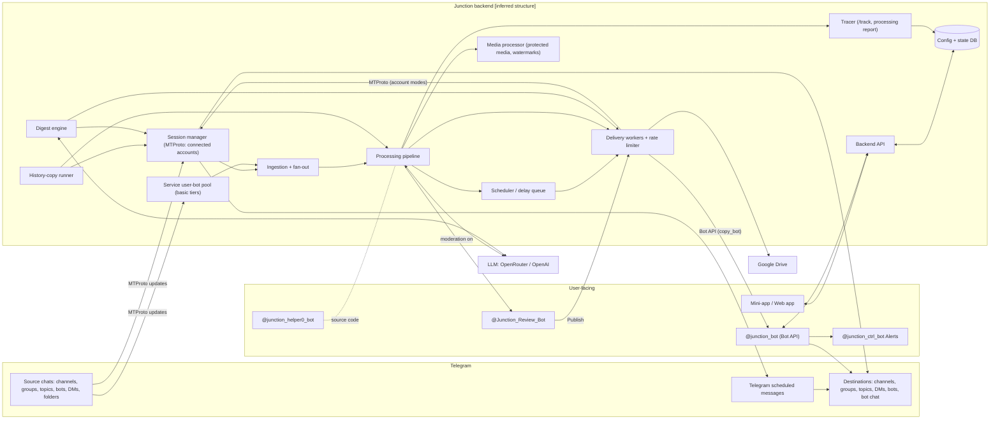
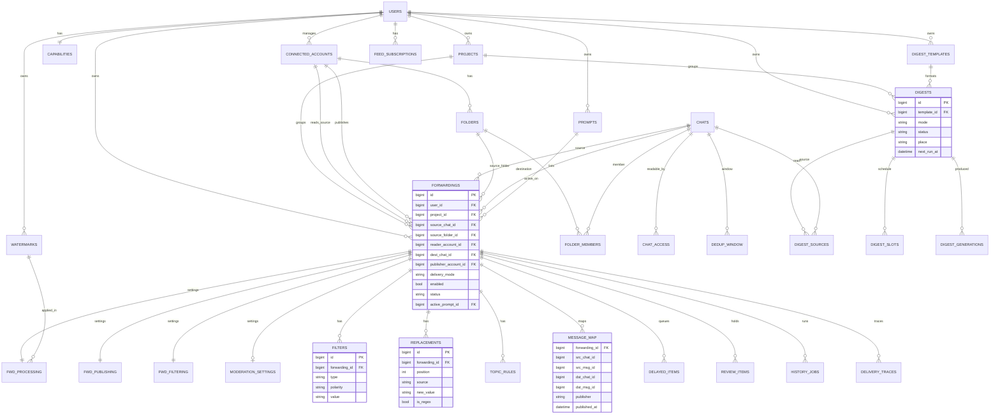
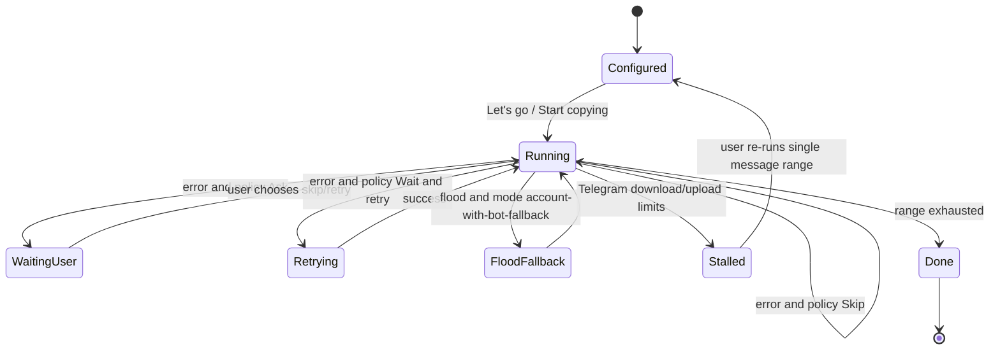
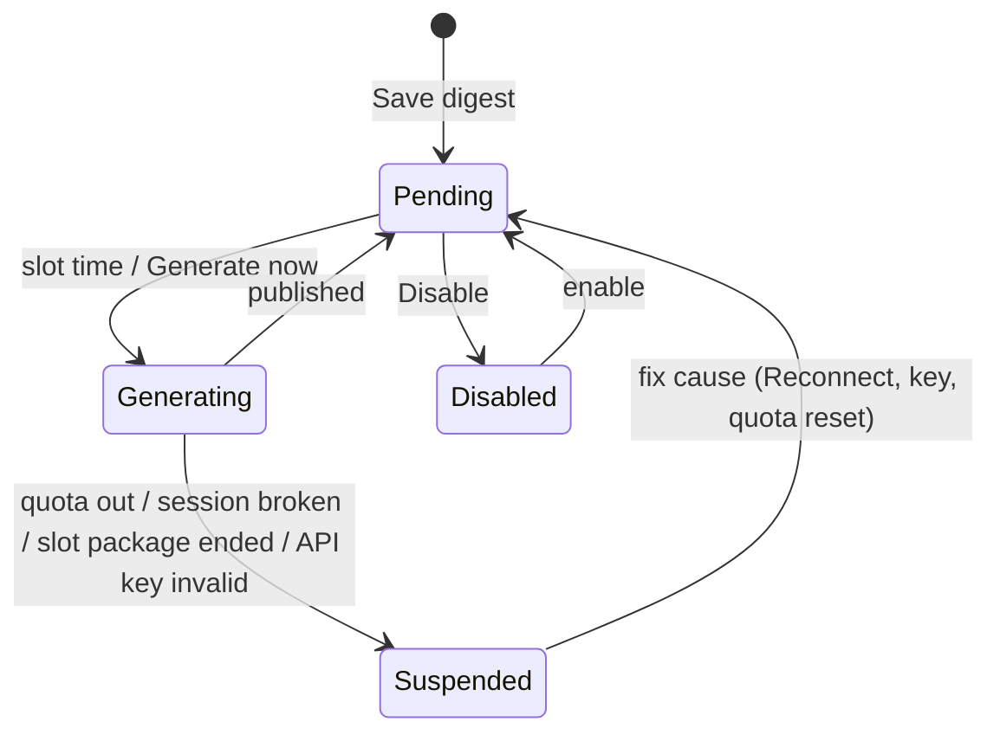
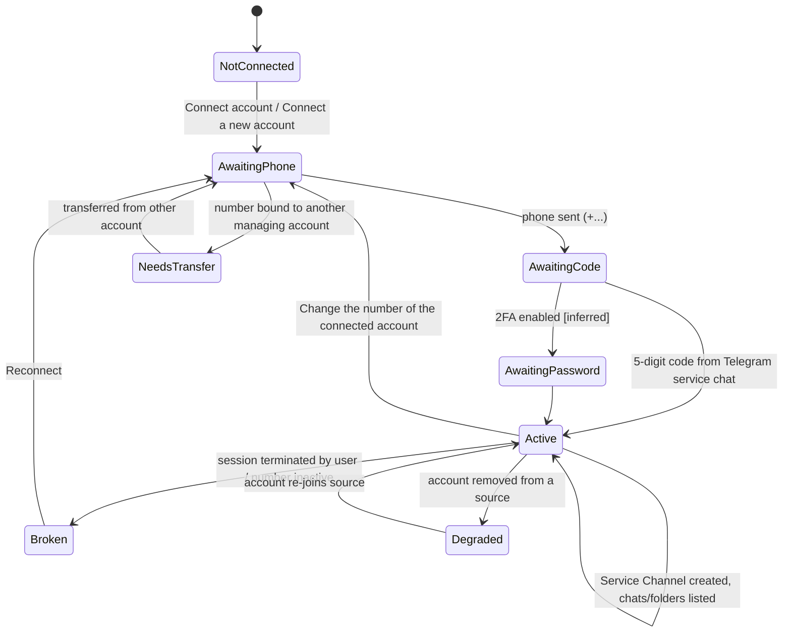
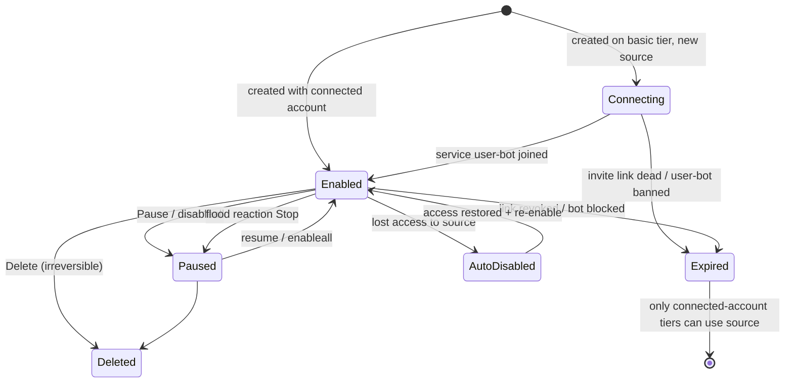

# Junction Bot — Architecture (entities, data model, processes)

A reconstruction of how Junction Bot is likely built, for agents that cannot open the website. Everything the public docs state is tagged **[doc]**. Everything we deduce (internal structure, table names, queue mechanics) is tagged **[inferred]**. The docs describe *behaviour*, not internals, so most of the *structure* below is [inferred] while the *rules* it must satisfy are [doc].

- **Sources:** `pages/*.md` and `features.md`. Feature IDs are written without the `JB-` prefix (e.g. `FLT-09`). UX details live in `ux-flows.md`.
- **Out of scope:** billing, prices, balance, promo codes. Plan tiers appear only as capability gates (`capabilities` in the schema).

---

## 1. System overview

### 1.1 What the product does, in architecture terms
- It is a **multi-tenant Telegram automation service** controlled through a Bot API bot (@junction_bot) plus a Telegram mini-app [doc, UI-01].
- It reads source chats through **MTProto user sessions**: either the customer's own "connected accounts" (userbots) or Junction's pooled **service user-bot** accounts on basic tiers [doc, ACC-01, ACC-08].
- Every incoming message runs through a per-**forwarding** pipeline (filters, replacements, AI, attribution, buttons, media) and is published by either the **bot** (Bot API) or the **connected account** (MTProto), as a copy or a native forward [doc, PUB-01].
- Side systems: delay/engagement queue, moderation via a second bot, history-copy jobs, AI digests (LLM over a batch of messages), Google Drive archiving, diagnostics (`/track`) [doc].

### 1.2 Components

| Component | Responsibility | Evidence |
|---|---|---|
| **Control bot** @junction_bot (Bot API) | Commands, the login dialog, notifications, own-feed delivery, "Copy via bot" publishing, digest posting as bot, inline channel search | CMD-*, TOP-09, PUB-01, CMD-15 [doc] |
| **Mini-app / Web app** (frontend + backend API) | CRUD over forwardings, digests, projects, prompts, watermarks; table view with saved layout | UI-01…14 [doc]. A REST/JSON backend for the mini-app [inferred]. |
| **Session manager** (MTProto client pool) | Holds the login sessions of connected accounts; login (phone + code); reconnect; per-account update stream; chat/folder listing | ACC-01/02/06 [doc]. "Connects as a separate Telegram client" [doc]. Pool and sharding [inferred]. |
| **Service user-bot pool** | Junction-owned accounts that join public / invite-link sources for basic tiers; "connecting…" while joining | ACC-08, DIAG-08 [doc] |
| **Ingestion workers** | Turn MTProto updates (new / edit / delete / topic events / story) into normalized events per source; fan out to the forwardings that use the source (including folders) | FWD-09/10, TOP-06, TOP-07 [doc behaviours]; worker design [inferred] |
| **Processing pipeline** | Filters, replacements, AI, service text, buttons, media caption, watermarks, link preview, etc. | §4.2 [doc order, partially] |
| **Scheduler / delay queue** | Bot-queue delays, delayed-filter checks, retries after flood, digest schedules, history pacing | PUB-04, FLT-07, PUB-10, DIG-11, HIST-04 [doc]; a single scheduler service [inferred] |
| **Delivery workers** | Publish via Bot API (bot) or MTProto (account); per-destination rate limiting; fallback (account → bot on flood; forward → copy on protection); pin, silent, preview; Telegram-native scheduling | PUB-01…10 [doc] |
| **Review bot** @Junction_Review_Bot | Shows held posts with Publish/Skip; handles callbacks | MOD-01…03 [doc] |
| **Alerts bot** @junction_ctrl_bot | Duplicate channel for system notifications | DIAG-07 [doc] |
| **Helper bot** @junction_helper0_bot | Renders a message's "source code" | DIAG-05 [doc] |
| **LLM gateway** | Calls OpenRouter (platform key or user key) or OpenAI (user key); free-mode default model; quota accounting | AI-05/06/07 [doc] |
| **History-copy runner** | Long-running jobs iterating message ranges with pacing and an error policy | HIST-* [doc] |
| **Digest engine** | Schedules, collects windowed messages with metadata, prompts the LLM, keeps past-digest memory, publishes | DIG-* [doc] |
| **Media processor** | Downloads/re-uploads protected media; overlays watermarks (image / video / animation) | FWD-19, PROC-17 [doc]. Probably ffmpeg/imaging [inferred]. |
| **Google Drive connector** | OAuth per user; uploads into `Junction Bot/<forwarding name>`; returns links | INT-01 [doc]. OAuth [inferred]. |
| **Tracer / diagnostics** | Per-message decision log for `/track` and the processing report; auto re-tune | DIAG-01/03 [doc]. A stored trace [inferred]. |
| **Database** | Configuration, mappings, dedup windows, jobs, traces | [inferred] |

### 1.3 Component diagram



---

## 2. Entities

Each entity lists its attributes, its relations and its evidence. Attribute names are illustrative [inferred]. The values and rules are [doc] where cited.

### 2.1 Managing account (user / owner)
- **What:** the Telegram user who talks to @junction_bot, owns the packages and configures everything [doc, ACC-03].
- **Attributes:** `telegram_user_id`, `language` (en/ru, `/language`) [doc, INT-04], capability set derived from packages [doc gates], `ai_mode` + key (§2.13), project list, alert preferences [inferred].
- **Relations:** 1→N connected accounts [doc]; 1→N projects [doc]; 1→N forwardings, digests, prompts, digest templates, watermarks [doc]; 1→1 Google Drive link [inferred].
- **Rules:** a phone number bound under another managing account must be *transferred* before it can be reused [doc, ACC-09]. A full move of settings to a new managing account is done by support [doc].

### 2.2 Capability set (plan gates only)
- **Attributes [inferred shape, doc values]:** `max_forwardings` (examples 25/100/unlimited), `max_connected_accounts` (= number of account packages), `allows_private_invite_sources` (Express+), `allows_closed_sources`/`account_modes`/`history`/`edits_sync` (Direct+), `expert_features` (stories, topic auto-sync, flood-fallback mode, cross-link replace, Max destination, unlimited folders), `advanced_filters_addon`, `digest_slots`, `digest_sources_max`, `generations_per_month`, `ai_free_processings`, `moderation_allowed`, `watermarks_allowed`, `projects_allowed`.
- **Rules:** gated features fail *silently* (e.g. word-form filters are ignored without the add-on) [doc, FLT-05].

### 2.3 Connected account (userbot session)
- **What:** a Telegram account that Junction logs into as a third-party client. It reads sources and can publish [doc, ACC-01].
- **Attributes:** `phone`, `tg_user_id`, `session` (MTProto auth key) [inferred], `status` (connected / broken / reconnecting) [doc behaviour], `has_premium` (affects captions, emoji, rich buttons) [doc], `service_channel_id` (the auto-created "Junction Bot Service Channel") [doc], `package_id` (each connection occupies one account package) [doc].
- **Relations:** N→1 managing account [doc]; 1→N forwardings as the **reader** of the source [doc, UI-11]; also the **publisher** in account delivery modes [doc]; actor in "Copy by script" [doc, HIST-07]; review-copy sender for moderation [doc].
- **Rules:** it sees only the chats it is a member of; if removed from a source, copying stops [doc]. Never block or delete the @junction_bot chat from it [doc]. A deleted session means it can neither receive nor send until Reconnect [doc].

### 2.4 Service user-bot (platform account)
- **What:** a Junction-owned userbot that joins sources for no-account tiers [doc, ACC-08].
- **Attributes [inferred]:** `account_id`, `joined_chats`, `ban_state`.
- **Rules:** a first-time source goes through **connecting…** [doc]. A banned user-bot or dead invite link makes the source **(expired)** [doc]. Economy latency is "usually up to an hour" [doc]. This suggests a shared, polled or batched reader for the cheapest tier [inferred].

### 2.5 Project
- **Attributes:** `id`, `owner_id`, `name`, `is_default` ("Project #1") [doc, PROJ-02].
- **Relations:** 1→N forwardings and 1→N digests; each item belongs to exactly one project [inferred from move semantics, PROJ-03].
- **Rules:** deletable only when empty [doc, PROJ-04]. "All projects" is a view, not an entity [inferred].

### 2.6 Chat (directory entry)
- **What:** any Telegram peer used as a source or destination.
- **Attributes:** `tg_chat_id` (`-100…` for channels/supergroups; author IDs of anonymous posts drop the `-100`) [doc, FLT-10]; `type` (channel / group / forum group / bot / user DM / discussion group) [doc]; `username`; `title`; `description` (used by the inline search) [doc, CMD-15]; `invite_link`; `is_protected` (no-forward flag) [doc, FWD-19]; `has_topics`; `linked_discussion_group_id` [doc, FWD-16]; `access_class` = open_public / open_private / protected / closed [doc, FWD-02].
- **Relations:** referenced by forwardings, digest sources, folders, moderation chats.

### 2.7 Folder (as source)
- **What:** a Telegram chat folder of a connected account, used as one source [doc, TOP-07].
- **Attributes:** `folder_id` (Telegram dialog-filter ID) [inferred], `title`, the explicit member list (counts of channels / groups / DMs shown) [doc].
- **Rules:** only explicitly listed peers count ("all channels" includes are ignored) [doc]. Membership changes apply automatically [doc]. A source in both a folder forwarding and a direct forwarding is delivered once, using the **direct** one's settings [doc, TOP-08]. Plan limit on folders (Direct 5, Expert unlimited) [doc-matrix].

### 2.8 Forwarding (core rule)
- **What:** exactly **one source → one destination** with settings [doc, FWD-01]. "Number of forwardings = number of source–destination pairs." One source can feed many destinations, and many sources can feed one destination, each pair being its own forwarding [doc].
- **Attributes:**
  - identity: `id`, `owner_id`, `project_id`, `created_at`, `updated_at` (both shown as table columns) [doc, UI-06];
  - `source_ref` (a chat **or** a folder), optional `source_topic` scope through topic mapping [doc];
  - `reader_account_id` (connected account or service user-bot; "phone of the account in the source" column) [doc];
  - `destination_chat_id`, `publisher_identity` (bot / account; "phone of the publishing account" column) [doc];
  - `type` = new messages / history (wizard choice) [doc, UI-02]. A history run is modelled as a job (§2.17) [inferred];
  - `enabled` / `status` (enabled, paused, auto-disabled, connecting…, expired) [doc, DIAG-08];
  - `delivery_mode` (§4.6) [doc];
  - settings groups (§2.9–2.12), `active_prompt_id` [doc], moderation settings [doc], debug flags [doc].
- **Rules:** a new forwarding starts with defaults and an **empty filter list** [doc, UI-03]. Messages per forwarding are unlimited [doc]. Commands address settings by **source link** (`/filter <src>`, `/settingchannel C`) [doc]. This hints at a legacy, source-keyed settings model ("subscriptions/redirections" in `/dump`) [inferred].

### 2.9 Topic mapping rule
- **Attributes:** `forwarding_id`, `src_topic_id` | `ALL` | `ALL_OTHER`, `dst_topic_id` | `MAIN/GENERAL` | (none for a channel / non-forum destination), `position` [doc, TOP-01/02].
- **Forwarding-level flags:** `auto_sync_topics` (Expert) [doc, TOP-06].
- **Rules:**
  - Default row: `ALL → MAIN` (or `ALL → destination` for non-forums) [doc].
  - Adding any explicit row converts `ALL` into `ALL_OTHER`, which also catches topics created later [doc].
  - Without a catch-all row, unmapped topics are not forwarded [inferred].
  - "Copy topic structure" creates the destination topics and the 1:1 rows plus `ALL_OTHER → MAIN` [doc].
  - Auto-sync creates and renames on topic events; it never deletes [doc].

### 2.10 Filter
- **Attributes:**
  - `forwarding_id`;
  - `type` ∈ {text, regex, word_form, datetime, author} — the editor types [doc];
  - `polarity` ∈ {mustHave, mustNotHave} [doc];
  - `value` (string / regex / word / `w135 9:30-17:30 Europe/Berlin` / numeric author ID) [doc];
  - `created_by_global` (from `/filterall`, removable per source) [doc, FLT-19].
- **Scope:** per forwarding. A folder forwarding applies its filters to **all** chats of the folder [doc, FLT-01]. There is no per-chat filter scope inside a folder [inferred].
- **Forwarding-level filter settings (not rows):**
  - `filter_order` ∈ {after_reception, after_replacements, after_ai} [doc, FLT-09];
  - `own_messages` ∈ {pass, filter} [doc];
  - `forwarded` ∈ {all, direct_only, forward_only} [doc];
  - `duplicates` ∈ {pass, filter, only_duplicates} [doc];
  - `every_n` (int, command only) [doc];
  - `delayed_filter` {from, to, metric, threshold, hourly_recheck} [doc, FLT-07/08].
- **Semantics:** §4.3.

### 2.11 Processing settings (per forwarding; all copy-only [doc, PROC-01])

| Setting | Values [doc] | ID |
|---|---|---|
| `header_text` | text/HTML (no automatic newline) | PROC-02 |
| `footer_text` | text/HTML | PROC-03 |
| `trim_length` | int, 0 = off | PROC-04 |
| `replacements[]` | ordered `{source, new_value, is_regex}`; append-only order | PROC-05/06 |
| `cross_link_replace` | variants (Expert) | PROC-10 |
| `source_name` | none / simple / bold / from_only / id / date / custom HTML | PROC-12 |
| `author` | none / name / username / full / full_except_bot | PROC-13 |
| `link_to_original` | none / full / custom text | PROC-11 |
| `copy_buttons` | none / url / special / all | FWD-12 |
| `notification_buttons` | none / `.*` / `<regex> [min-max] [body]` | FWD-13 |
| `own_buttons` | lines `<url> <label>` | PROC-14 |
| `feedback_buttons` | none / 1 / 2 / custom words | PROC-15 |
| `media_caption` | separate / caption_name / text_only | PROC-16 |
| `watermark` | `{watermark_id, on_image, on_video, on_animation}` | PROC-17 |
| `polls` | none / copy / custom text | FWD-14 |
| `stories` | message / ignore | FWD-15 |
| `comments_source_channel_id` | numeric | FWD-16 |
| `link_preview` | pass / never / always | PUB-09 |

Service text (source name, author, link to original) is **not** touched by replacements [doc, PROC-05].

### 2.12 Watermark preset
- **Attributes:** `id`, `owner_id`, `name`, `png_file`, `opacity` (higher = more transparent; scale unknown), `scaling` ∈ {fit, cover, none}, `alignment` ∈ {center, the sides, the corners, random} [doc, PROC-18].
- **Relations:** N forwardings reference 1 preset [doc: "choose from previously uploaded"].

### 2.13 AI prompt and AI settings
- **Prompt** [doc, AI-02…04]:
  - attributes: `id`, `owner_id` (null for library prompts), `origin` ∈ {library, user}, `copied_from_id`, `name`, `description`, `text`, `creativity` (temperature, recommended 0.7), `model` (only in paid/own-key modes).
  - Rules: editing a library prompt always creates a user copy [doc]. One prompt can be active on many forwardings, so an edit affects all of them [doc] (a shared reference, not a copy-on-apply). At most **one active prompt per forwarding** [doc].
- **Forwarding ↔ prompt:** `forwarding.active_prompt_id` (nullable) [inferred from "Active prompt" block].
- **AI settings (per managing account, global)** [doc, AI-05]:
  - `mode` ∈ {free, balance, own_key};
  - `provider` ∈ {openrouter, openai} for own_key;
  - `api_key` (encrypted [inferred]);
  - quota counters: free processings / 30 days; digest generations / month [doc, AI-07].
  - The mode is shared by forwardings, digests and "other AI services" [doc]. Free mode = one locked default model (Gemini 3 Flash Preview per the digests doc) [doc, AI-06].
  - Balance mode routes via OpenRouter with automatic provider selection [doc].

### 2.14 Moderation settings and review item
- **Settings (per forwarding):** `enabled`, `review_chat` ∈ {@Junction_Review_Bot (default), chosen group/channel} [doc, MOD-01/02].
- **Effects:** forces `delivery_mode = copy_client`, drops the original buttons, disables edit sync [doc, MOD-04].
- **Review item [inferred shape]:**
  - attributes: `id`, `forwarding_id`, `source_msg_ref`, `review_chat_id`, `review_msg_id` (posted by the connected account [doc]), `status` ∈ {pending, published (count ≥ 1), skipped}, `created_at`.
  - Publishing copies the **current** content of the review message, which may have been edited by the user [doc]. That implies re-reading the review message at publish time [inferred]. Re-publish is allowed [doc].
  - Timeouts are undocumented.

### 2.15 Delivery settings (per forwarding)
- `delivery_mode` (6 values, §4.6) [doc].
- `delay` {from, to} — internal bot queue, not viewable or editable [doc, PUB-04]. It is the same object as the delayed filter's window [doc: "same setting" in two places].
- `schedule` {from, to} — Telegram-native scheduled messages; needs an account mode [doc, PUB-05].
- `frequency_seconds` — minimum gap per **source**, implemented through the Telegram scheduler; needs an account mode [doc, PUB-06].
- `pin` ∈ {off, pass, silent, notify} [doc, PUB-07]; `silent` ∈ {pass, never, always} [doc, PUB-08]; `link_preview` [doc].
- `flood_reaction` ∈ {ignore, stop, postpone (default)} + `notify_on_flood` [doc, PUB-10]. Whether "notify" combines with the others is unknown; modelled here as a flag [inferred].
- `forward_edits` ∈ {edit, new, ignore}; `forward_deletions` ∈ {yes, no} [doc, FWD-09/10].
- `gdrive` {mode ∈ text/media/both, send_nothing} [doc, INT-01].
- Debug: `processing_report` bool [doc, DIAG-03].

### 2.16 Message mapping (source ↔ destination)
- **Why it must exist [inferred, from doc behaviours]:**
  - edit propagation (`edit` mode updates the destination copy) [doc, FWD-09];
  - deletion propagation [doc, FWD-10];
  - comments-as-comments: a discussion-group message replying to source post X must be attached to destination post X′, which is why the user supplies the source channel ID [doc, FWD-16];
  - re-publish from moderation;
  - `/track` "was it delivered" [doc, DIAG-01];
  - the `id` source-name mode and links to the original [doc].
- **Attributes [inferred]:** `forwarding_id`, `src_chat_id`, `src_msg_id` (album: `grouped_id`), `dst_chat_id`, `dst_msg_ids[]` (one source message may become 2 with `separate` captions), `publisher` (bot/account), `published_at`, `content_hash` (for the duplicate filter), `state` (queued / published / dropped / scheduled-in-telegram).
- **Constraint:** the Bot API cannot delete messages older than **48 h** → deletion sync of older copies requires account publishing [doc].

### 2.17 History-copy job
- **Attributes:**
  - `forwarding_id` (a new or existing forwarding) [doc];
  - `interval` ∈ {all, msg_id_range(from, to), time_range(from, to)} [doc, HIST-02];
  - `sender`/`delivery_mode` (bot / account / account-with-bot-fallback) [doc];
  - `remove_safe_pause` bool [doc];
  - `error_policy` ∈ {ask, skip, wait_retry} [doc];
  - `copy_by_script` bool [doc];
  - `status` (running / waiting-for-user / stalled / done) [inferred];
  - `cursor` (last processed message ID) [inferred];
  - `started_at`.
- **Rules:**
  - Messages are copied in original order with the **current date** [doc].
  - The forwarding's filters and processing apply [doc, HIST-08].
  - Topic mapping can restrict which topics are copied [doc, HIST-09].
  - Google Drive must be enabled before the start [doc].
  - A start notice with the source chat ID is posted in the bot chat [doc].

### 2.18 Digest
- **Digest:**
  - attributes: `id`, `owner_id`, `project_id`, `name` (auto default) [doc], `template_id`, `mode` ∈ {scheduled, instant} [doc], `status` ∈ {pending, generating, disabled, suspended(reason)} [doc, DIG-14], `next_run_at` ("tomorrow at 19:00") [doc].
  - `place` ∈ {bot_chat, external_chat} + `publish_as` ∈ {bot, account} [doc]. The marketing page says "one or more target chats" [doc-features; docs say one].
- **DigestSource:** `digest_id`, `chat_id`, `topics` ∈ {ALL | list} (ALL = 1 slot; each picked topic may count as a source) [doc, DIG-10].
- **ScheduleSlot:** `digest_id`, `weekday` (1–7 or "all days"), `time` (several per day) [doc, DIG-11]. The timezone is undocumented [inferred: per user].
- **DigestTemplate:**
  - attributes: `origin` ∈ {library, user}, `name` ("News overview", "Group discussions"), `prompt_text`, `model`, `temperature` (0–2 in steps of 0.1, default 0.7), `consider_past` (0–10, free mode ≤ 1, system templates default 1) [doc, DIG-05/06/07].
  - Editing a library template creates a copy in My templates [doc].
- **DigestGeneration:** `digest_id`, `kind` ∈ {scheduled, instant, generate_now, preview}, `period` (week / since last) [doc for preview], `messages_used` (≤ 50 in free mode; window ≤ 1 week) [doc, DIG-16], `output_text`, `usage` (generations or tokens) [doc], `success` (only successful ones count as "past digests") [doc], `published_msg_ref`.

### 2.19 Delivery trace (report record)
- **What:** a per source-message, per-forwarding record of pipeline decisions, used by `/track` and the processing report [doc behaviour, DIAG-01/03; stored shape inferred].
- **Attributes [inferred]:** `forwarding_id`, `src_msg_ref`, `received_at`, `source_code` (the HTML form + media tokens) [doc: shown in reports], `content_types` [doc: "the message contained a video"], `steps[]` (filter type + polarity + value that decided [doc]; replacements applied; AI used; delay/schedule), `outcome` ∈ {delivered, blocked_mustHave, blocked_mustNotHave, dropped_other, pending, failed}, `dst_msg_ref`.
- The processing report must be enabled *before* the message arrives [doc]. `/track` works afterwards [doc]. So `/track` either replays the pipeline on demand or reads a trace that is always kept [inferred, both plausible]. `/track` also "re-tunes the forwarding" [doc], e.g. by refreshing the source subscription or access hash [inferred].

### 2.20 Duplicate-detection window
- **Per source** [doc: "remembers the last 300 messages in the source"]: a ring buffer of 300 content fingerprints that ignore buttons [doc]. It resets after **24 h** without messages [doc]. It compares **source originals**, i.e. before replacements [doc].
- Not available with `forward_client` [doc]. The edit edge case: delete the first duplicate then edit the second → the edit does not pass [doc].

### 2.21 Own-feed subscription
- `owner_id`, `chat_id` or `invite_link` → delivered into the user's bot chat [doc, TOP-09]. Exported by `/dump` as "subscriptions" [doc].

### 2.22 Google Drive integration
- Per managing account: an OAuth token [inferred]. Per forwarding: the mode and the send-nothing flag [doc]. Folder layout `Junction Bot/<forwarding name>/` [doc]. Links replace the files in the destination [doc].

### 2.23 Alerts and service channel
- Notifications (flood bans, history errors, billing reminders [doc], digest suspensions [inferred]) go to the main bot chat and optionally to the Alerts bot [doc, DIAG-07].
- The **Service Channel** lives on each connected account [doc]. Its purpose is unspecified. Plausibly it stores intermediate copies, e.g. re-uploaded protected media, review drafts, or media for bot/account hand-off [inferred].

---
## 3. Data model [inferred relational schema]

The docs give the entities and rules. Table and column names are ours. Settings with many scalar options could just as well be one JSON column per group. They are listed as columns for clarity.

### 3.1 Tables

| Table | Key columns | FKs / notes |
|---|---|---|
| `users` | `id` PK = Telegram user ID; `language`; `ai_mode`; `ai_provider`; `ai_api_key_enc`; `ai_free_used`; `ai_free_period_start`; `gen_used_month` | The managing account |
| `capabilities` | `user_id` PK; `max_forwardings`; `max_accounts`; `tier_flags` (bitset: private_invite, closed, account_modes, history, expert, adv_filters, moderation, watermarks, projects); `digest_slots`; `digest_sources_max`; `generations_month` | FK users. Derived from packages; billing tables are out of scope. |
| `connected_accounts` | `id` PK; `user_id`; `phone`; `tg_user_id`; `session_blob_enc`; `status` (active / broken / pending_code); `has_premium`; `service_channel_id`; `created_at` | FK users. UNIQUE(`phone`) across users → explains "transfer number" [doc] |
| `service_userbots` | `id` PK; `session_blob_enc`; `status` | Platform pool |
| `chats` | `id` PK = Telegram chat ID; `type`; `username`; `title`; `description`; `invite_link`; `is_protected`; `has_topics`; `linked_chat_id` | Global directory; feeds the inline search |
| `chat_access` | (`chat_id`, `reader_kind`, `reader_id`) PK; `state` (connecting / ok / expired); `access_hash` | Which session can read a chat; drives connecting… / (expired) |
| `folders` | `id` PK; `account_id`; `tg_filter_id`; `title`; `synced_at` | FK connected_accounts |
| `folder_members` | (`folder_id`, `chat_id`) PK | Refreshed automatically [doc behaviour] |
| `projects` | `id` PK; `user_id`; `name`; `is_default` | Delete only if no children |
| `forwardings` | `id` PK; `user_id`; `project_id`; `source_chat_id` NULL; `source_folder_id` NULL (exactly one set); `reader_account_id` NULL (null = service user-bot); `dest_chat_id`; `publisher_account_id` NULL; `delivery_mode`; `enabled`; `status`; `active_prompt_id` NULL; `created_at`; `updated_at` | FKs users, projects, chats, folders, connected_accounts, prompts |
| `fwd_processing` | `forwarding_id` PK; `header`; `footer`; `trim_len`; `cross_link_mode`; `source_name`; `author`; `link_original`; `copy_buttons`; `notif_buttons`; `own_buttons`; `feedback_buttons`; `media_caption`; `polls`; `stories`; `comments_src_channel_id`; `link_preview`; `watermark_id`; `wm_image`; `wm_video`; `wm_animation` | 1:1 with forwardings |
| `fwd_publishing` | `forwarding_id` PK; `delay_from`; `delay_to`; `delay_metric`; `delay_threshold`; `delay_hourly`; `schedule_from`; `schedule_to`; `frequency_s`; `pin`; `silent`; `flood_reaction`; `flood_notify`; `forward_edits`; `forward_deletions`; `gdrive_mode`; `gdrive_send_nothing`; `processing_report` | 1:1 |
| `fwd_filtering` | `forwarding_id` PK; `filter_order`; `own_messages`; `forwarded`; `duplicates`; `every_n`; `every_n_counter` | 1:1 |
| `filters` | `id` PK; `forwarding_id`; `type` (text / regex / word_form / datetime / author); `polarity` (mustHave / mustNotHave); `value`; `global_origin` bool | Many per forwarding |
| `replacements` | `id` PK; `forwarding_id`; `position` (append-only); `source`; `new_value`; `is_regex` | Ordered |
| `topic_rules` | `id` PK; `forwarding_id`; `src_topic` (ID / ALL / ALL_OTHER); `dst_topic` (ID / MAIN / NULL); `position` | + `forwardings.auto_sync_topics` |
| `watermarks` | `id` PK; `user_id`; `name`; `file_ref`; `opacity`; `scaling`; `alignment` | |
| `prompts` | `id` PK; `user_id` NULL (library); `copied_from_id`; `name`; `description`; `text`; `temperature`; `model` | Shared by reference |
| `moderation_settings` | `forwarding_id` PK; `enabled`; `review_chat_id` NULL (null = review bot) | |
| `review_items` | `id` PK; `forwarding_id`; `src_chat_id`; `src_msg_id`; `review_chat_id`; `review_msg_id`; `status`; `publish_count`; `created_at` | |
| `delayed_items` | `id` PK; `forwarding_id`; `src_msg_ref`; `payload_ref`; `due_at`; `window_end_at`; `check_metric`; `threshold`; `next_check_at`; `state` | Bot queue + engagement checks |
| `message_map` | `id` PK; `forwarding_id`; `src_chat_id`; `src_msg_id`; `src_group_id`; `dst_chat_id`; `dst_msg_id`; `part` (media / text); `publisher`; `published_at`; `tg_scheduled` bool | INDEX(src_chat_id, src_msg_id) for edits and deletes |
| `dedup_window` | (`source_chat_id`, `seq`) PK; `fingerprint`; `seen_at` | Keep 300 per source; purge if the newest is more than 24 h old |
| `history_jobs` | `id` PK; `forwarding_id`; `interval_kind`; `from_val`; `to_val`; `mode`; `remove_safe_pause`; `error_policy`; `by_script`; `cursor`; `status`; `started_at`; `finished_at` | |
| `delivery_traces` | `id` PK; `forwarding_id`; `src_chat_id`; `src_msg_id`; `source_code`; `content_types`; `decision_json`; `outcome`; `created_at` | Retention unknown |
| `digests` | `id` PK; `user_id`; `project_id`; `name`; `template_id`; `mode`; `status`; `suspend_reason`; `place`; `dest_chat_id`; `publish_as_account_id` NULL; `next_run_at` | |
| `digest_sources` | `id` PK; `digest_id`; `chat_id`; `topics_json` (ALL or list) | |
| `digest_slots` | `id` PK; `digest_id`; `weekday` (0 = every day); `time_local` | |
| `digest_templates` | `id` PK; `user_id` NULL (library); `copied_from_id`; `name`; `prompt_text`; `model`; `temperature`; `consider_past` | |
| `digest_generations` | `id` PK; `digest_id`; `kind`; `period_from`; `period_to`; `msg_count`; `output`; `usage_json`; `success`; `published_ref`; `created_at` | Last N successful rows feed `consider_past` |
| `feed_subscriptions` | `id` PK; `user_id`; `chat_id`; `invite_link` | Own feed in the bot chat |
| `gdrive_links` | `user_id` PK; `oauth_token_enc`; `root_folder_id` | |
| `notifications` | `id` PK; `user_id`; `kind` (flood / history_error / suspend / system); `payload`; `delivered_to` (main / alerts) | |

### 3.2 ER diagram



---
## 4. Processes and pipelines

### 4.1 Message ingestion
- **Readers.** Each forwarding's source is read by one session:
  - a **connected account** chosen per forwarding ("Change source → pick connection") [doc, UI-11];
  - or, on basic tiers, a **service user-bot** that joins the source when the forwarding is created [doc, ACC-08].
  - The bot itself (Bot API) cannot read arbitrary channels: "bots cannot write first, join chats, or publish premium content" [doc, features__account-connection]. So all ingestion is MTProto [inferred, strongly implied].
- **Update types consumed:**
  - new messages and albums [doc, FWD-11];
  - edits [doc, FWD-09];
  - deletions [doc, FWD-10];
  - forum topic create/rename [doc, TOP-06];
  - stories [doc, FWD-15];
  - discussion-group messages for comments [doc, FWD-16];
  - callback-button pop-ups, obtained by the bot *pressing* the button (`messages.getBotCallbackAnswer`-style) after a random delay [doc behaviour, FWD-13; API inferred];
  - reaction/view/forward/reply counters polled for delayed filters [doc behaviour, FLT-07; polling inferred].
- **Latency tiers** [doc]: Economy "usually up to an hour" (shared / batched polling of public channels [inferred]); Express instant once the service user-bot has joined; Direct/Expert instant ("~2 s / ~1 s" per the matrix). Protected media adds re-processing time [doc].
- **Fan-out:** one source event → every enabled forwarding on that source, plus folder forwardings whose folder contains the chat. If the chat is also a direct source, the folder copy is suppressed and the direct forwarding's settings are used [doc, TOP-08]. Mechanism [inferred]: resolve per (source, destination) or per message ID across the user's forwardings.
- **No outbound webhooks/API (by design)** [doc, INT-05]. The stated reason: HTTP callbacks get lost or duplicated, and users would need replay and logs. The recommended alternative: forward into your own bot and treat Telegram as the message queue. Consequence: integrations are built as **forwardings to bots** (FWD-05, PROC-19) [doc].

### 4.2 Processing order (per forwarding, per message)

Documented anchors [doc]:
- The filter position is set by **Filtering order**:
  - `after reception` = Filters → Replacements → AI;
  - `after replacements` = Replacements → Filters → AI;
  - `after ai` = Replacements → AI → Filters (FLT-09).
- Replacements run top-to-bottom, then the automatic cross-link replacement (PROC-05/10).
- Replacements never touch the service text (source name, author, link to original) (PROC-05).
- Filters see the HTML "source code" with media tokens and possibly a trailing space appended (FLT-04).
- The duplicate filter compares **source originals** (FLT-15).
- Moderation receives posts *after* filters and replacements (MOD-04).
- A delay that has not elapsed when the original is edited means the edit is not applied (FWD-09).
- The author line is filterable by a text filter *on the same forwarding*, yet not replaceable there (FLT-10). So the filter input includes the service text while the replacement input is body-only [inferred from the doc recipe].

Reconstructed full pipeline [inferred ordering except where tagged]:

| # | Stage | What happens | Tag / IDs |
|---|---|---|---|
| 0 | Receive | Event from the reader session; build the normalized message (text as Telegram-HTML, entities → tags, premium emoji as `<strong documentid=…>`, media list, album group, buttons, forward origin, author, topic) | DIAG-04 [doc for the representation] |
| 1 | Route | Forwarding enabled? Topic mapping: does the source topic match a row (explicit, ALL or ALL_OTHER)? → target topic. No row → drop. | TOP-01/02 [doc rules; drop inferred] |
| 2 | Cheap gates | Stories (message/ignore), polls (none/copy/link), forwarded filter (all/direct/forward), own-messages filter, every-N counter | FWD-14/15, FLT-11/13/14 [doc]; position [inferred] |
| 3 | Duplicate filter | Fingerprint of the original (buttons ignored) vs the 300-message window of the source → pass / drop / only_duplicates | FLT-15 [doc] |
| 4 | Filters (if `after reception`) | Per type in sequence (text → regex → word forms → date/time → author …). Any type that vetoes stops the message. | FLT-02 [doc] |
| 5 | Replacements | Ordered rules on body + button texts + notification pop-up text; then cross-link replacement (Expert) | PROC-05/06/10, FWD-13 [doc] |
| 6 | Filters (if `after replacements`) | As in 4 | FLT-09 [doc] |
| 7 | AI | Active prompt on the **text only**; model and temperature from the prompt / AI mode; counts against the quota | AI-01/05/07 [doc] |
| 8 | Filters (if `after ai`) | As in 4. This is the AI-marker pattern (РЕКЛАМА, ПРОПУСК, НЕ_ЛИД). | FLT-16 [doc] |
| 9 | Empty check | Text emptied and no media → not sent | PROC-06 ex. 11 [doc example; rule inferred] |
| 10 | Compose | Trim to N chars; header + source-name/author block + body + footer + link-to-original; own/feedback/copied buttons depending on the mode; media-caption split (separate / caption_name / text_only); caption limit 1024 (×4 with Premium in account mode); link-preview flag | PROC-02…04, 11…16, FWD-17 [doc settings; order inferred] |
| 11 | Media | Re-upload protected media; overlay the watermark on image / video / animation | FWD-19, PROC-17 [doc] |
| 12 | Moderation | If enabled → post to the review chat via the connected account; wait for Publish/Skip | MOD-01…04 [doc] |
| 13 | Delay / delayed filter | Bot queue until `from` (or random in [from, to]); with a condition, check the source message's counters at the window start and end (and hourly if ticked); fail → drop | PUB-04, FLT-07/08 [doc]; relative order to moderation [inferred] |
| 14 | Schedule / frequency | Account mode: hand to Telegram's scheduled messages at now + offset, or at the next free frequency slot for this source | PUB-05/06 [doc] |
| 15 | Deliver | By delivery mode (§4.6); rate limit; flood reaction; fallbacks; pin / silent; Google Drive (upload, then send links, or send nothing) | PUB-01…10, INT-01 [doc] |
| 16 | Record | `message_map`, `delivery_traces`, processing report if enabled | DIAG-01/03 [doc behaviour] |

```mermaid
sequenceDiagram
    autonumber
    participant SRC as Source chat
    participant RD as Reader session (connected account / service user-bot)
    participant ING as Ingestion + fan-out
    participant P as Pipeline (per forwarding)
    participant AI as LLM
    participant MOD as Review chat
    participant Q as Scheduler / delay queue
    participant DLV as Delivery worker
    participant DST as Destination
    SRC->>RD: new message (MTProto update)
    RD->>ING: normalized event
    ING->>ING: find forwardings (direct + folders, direct wins)
    ING->>P: message x forwarding
    P->>P: topic routing, cheap gates, duplicate window
    alt filter order = after reception
        P->>P: filters on original
    end
    P->>P: replacements, then cross-link replace
    alt filter order = after replacements
        P->>P: filters
    end
    opt active prompt
        P->>AI: text + prompt
        AI-->>P: rewritten text
    end
    alt filter order = after ai
        P->>P: filters (AI marker words)
    end
    P->>P: compose (header, source info, footer, buttons, caption mode), watermark
    opt moderation on
        P->>MOD: review copy via connected account
        MOD-->>P: Publish (current version) or Skip
    end
    opt delay / delayed filter
        P->>Q: enqueue due_at, checks
        Q->>SRC: read reactions/views/forwards/replies
        Q-->>P: release or drop
    end
    P->>DLV: deliver (mode, pin, silent, preview, schedule/frequency)
    DLV->>DST: Bot API send or MTProto send/forward/schedule
    alt flood ban
        DLV->>DLV: ignore / stop forwarding / postpone+retry / notify; account->bot fallback
    end
    DLV->>P: dst message ids
    P->>P: write message_map + trace
```

### 4.3 Filter evaluation semantics [doc, FLT-02]
- Group the filter rows by **type**. For each type, in sequence:
  - `allow = [r for r if polarity == mustHave]`;
  - `block = [r for r if polarity == mustNotHave]`;
  - if `allow` is non-empty and none matches → STOP (report: "hit mustHave filter");
  - if any of `block` matches → STOP (report: "hit mustNotHave filter").
- Pass only if every type passes (AND across types; OR within a polarity).
- Matchers:
  - **text**: case-sensitive substring [doc].
  - **regex**: Java-8 regex over the whole source code including media tokens. Docs advise wrapping with `.*` and say the engine behaves like regex101 with "single line + global" [doc]. There is a contradiction about `.` matching newlines (see `features.md` #10).
  - **word_form**: lemmatized match for RU/EN/UK/DE, case-insensitive, first word only. Silently skipped without the add-on [doc].
  - **datetime**: weekday set + inclusive time window in an IANA zone (default UTC), evaluated at **arrival** time; out-of-window messages are dropped [doc].
  - **author**: numeric sender ID (anonymous admin = chat ID without `-100`) [doc].
- Media tokens appended to the text: `<photo> <document> <audio> <video> <sticker> <voice> <location> <animation> <videonote> <poll>` [doc]. Albums produce repeated tokens (`(\s*<photo>)+\s*`) [doc]. An album is therefore evaluated as one unit [inferred].

### 4.4 Delay queue and delayed (engagement) filters
- **Bot queue** [doc, PUB-04]: the item is held until `src_time + from`, or a uniform random time in `[from, to]`. Queued items cannot be listed, edited or cancelled by the user. Edits to the original during the wait are not applied.
- **Delayed filter** [doc, FLT-07/08]:
  - Checks happen at `src_time + from` and `src_time + to` (plus hourly in between if "repeat hourly" is ticked; windows under 1 h get just 2 checks).
  - At each check the source message's counters (reactions, views, forwards, replies, or ratios to views) are read. Threshold met → release to delivery. Otherwise schedule the next check; after the last check → drop.
  - With only `from` set, the doc example implies a single check [inferred].
  - Whether several metric conditions can be combined is undocumented.
- **Implementation [inferred]:** a `delayed_items` table polled by a scheduler with `next_check_at`; counters fetched through the reader session (`messages.getMessagesViews` / reactions APIs).
- **Postpone on flood** [doc, PUB-10] reuses the same queue for retries after the ban expires. Under sustained overload the backlog grows and the oldest items are eventually ignored [doc].

### 4.5 Moderation queue
1. After the pipeline (filters, replacements; and AI, per the filter order [inferred]) the item is not delivered. Instead the **connected account** posts a copy into the review chat [doc]. Using the account (not a bot) is what makes the copy editable by the user [doc].
2. @Junction_Review_Bot attaches the source/destination info and Publish/Skip buttons [doc]. In a custom chat, the review bot and the account must both be admins, otherwise `NO_ACCESS` [doc]. Mechanism [inferred]: the account posts the message, then the review bot replies or edits a control message, or the account posts through the bot via an inline query.
3. **Publish** → read the current review message (text and media as edited) → copy it to the destination via the account (`copy_client`) [doc]. Repeatable [doc].
4. **Skip** → mark it skipped [doc].
5. Constraints [doc]: no original buttons; source edits are not propagated afterwards. Scheduling approved posts and team collaboration are marketing claims (MOD-05).

### 4.6 Delivery modes and rate limiting

| Mode (EN / RU) | Internal ID | Publisher | Copy / forward | Destination requirements | Processing | Buttons | Fallback | Gate |
|---|---|---|---|---|---|---|---|---|
| Copy via bot (Копировать через бота) | `copy_bot` [doc] | Bot API | copy | bot **and** the user (or one of the user's connected accounts) are admins; the bot can post | all | native own, feedback and copied URL buttons | — | any |
| Copy via account (Копировать через аккаунт) | `copy_client` [doc] | MTProto account | copy | the account can post | all | only with Premium (rich text, link buttons); no feedback buttons | — | Direct+ |
| Copy via account, on flood — via bot (…при флуде - через бота) | — | account → bot on flood | copy | the account can post; the bot is admin with posting rights | all | as the actual publisher | bot on a flood error; 40–60 msg/min | Expert |
| Forward via account (Пересылать через аккаунт) | `forward_client` [doc id; mapping inferred] | account | native forward | the account can post; the source allows forwarding | **none** | none | — | Direct+ |
| Copy regular and forward forwards via account (Копировать обычные и пересылать форварды через аккаунт) | "copy or forward client" [doc] | account | copy for own posts, forward for forwarded-in posts | the same | own posts only [inferred] | — | forwarded-in posts in protected sources are **skipped** | Direct+ |
| Forward via account, on protection — copy (Пересылать через аккаунт, при защите - копировать) | — | account | forward, copy if protected | the same | only on the copy path [inferred] | — | copy on protection | Direct+ |

- **Forced modes** [doc]: destinations that are DMs or bots are always delivered via the account. Moderation forces `copy_client`. Telegram-native schedule and delivery frequency require an account mode.
- **Rate limits** [doc]: Telegram allows ~20–30 posts/min per destination, then a temporary posting ban. No permanent bans are known for flood.
- **Flood reaction** [doc, PUB-10]:

  | Option | Behaviour |
  |---|---|
  | Ignore | Drop messages that hit the ban |
  | Stop | Pause the forwarding (`enabled = false`) until the user re-enables it |
  | Postpone (default) | Retry after the ban; the backlog can snowball |
  | Notify | Message in the bot chat |
- **Throughput tactics** [doc]: account mode ("softer limits"); flood fallback (40–60/min); frequency spreading; several connected accounts; several destination channels. History has its own "safe pause" throttle (HIST-04).
- **Limits per publisher [inferred]:** the rate limiter is keyed by (publisher identity, destination), because the doc says splitting across accounts or channels helps.

### 4.7 Edit and delete propagation
- **Edits** (Direct+, copy modes only) [doc, FWD-09]:
  - On a source edit, look up `message_map` by (src_chat, src_msg) [inferred] and re-run the pipeline on the new content [inferred, because filters apply: "if the original didn't pass filters, the edit can't pass; if the original passed but the edit doesn't, the copy is not changed" — doc].
  - `edit` → edit the destination message(s) in place; `new` → publish the edited version as a new message (every edit, so it can look like duplicates); `ignore`.
  - Not applied: when the item is still in the delay queue; under moderation; under native-forward modes.
  - The edit is performed by the same publisher identity [inferred]. The Bot API can edit only the bot's own messages [inferred from Telegram rules].
- **Deletions** (Direct+) [doc, FWD-10]: `yes` → delete all mapped destination copies. The bot can only delete messages younger than **48 h**; older ones need account publishing [doc]. Fixes the "source posted twice then deleted one" duplicate case [doc, DIAG-09].
- **Edge case** [doc]: with the duplicate filter, if the admin deletes the first copy and then edits the second, the edit does not pass (the second was dropped as a duplicate, so there is no mapping).

### 4.8 History-copy job lifecycle
1. **Create** from the wizard ("Old messages (history)") or from a configured forwarding ("Copy old messages") [doc]. Needs a connected account as reader [doc, HIST-01].
2. **Resolve the range** [doc, HIST-02]: all; message-ID range (Telegram IDs, not ordinal positions); publication-time range. The iteration source is the reader account's message history (MTProto history pagination, oldest → newest to keep order) [inferred].
3. **Run** [doc]:
   - post the start notice in the bot chat with the source chat ID;
   - for each message: the forwarding pipeline (filters, replacements, AI, topic mapping, buttons, polls, Google Drive) → publish with the chosen sender;
   - copies get the current timestamp; the original dates cannot be set.
4. **Pacing** [doc]: by default a "safe pause" throttles posting below Telegram limits. "Remove safe pause" disables it, which risks a temporary posting ban. Expert's "copy via account, on flood → via bot" switches publisher on a flood error.
5. **Copy by script** [doc, HIST-07]: for each message, choose the connected account whose Telegram ID equals the original author [inferred matching] and post as that account. Sleep for the original inter-message gap (`t[i] − t[i−1]`) [doc: "pauses preserved"]. All actors must be in the destination with posting rights [doc].
6. **Errors** [doc, HIST-05]: Ask → pause the job and prompt the user in the bot chat (`waiting_for_user`) [inferred state]; Skip → log and continue; Wait and retry → back off and retry the same message until it succeeds.
7. **Stall** [doc, HIST-10]: the account's media download/upload quota is exhausted, so the job appears stuck. Recovery is manual: disable auto-download, idle the account 12 h, re-run a one-message ID range, or get Premium.
8. **Done** → completion notice [inferred]. Unanswered questions: whether the job also leaves the forwarding live for new messages; whether jobs can be cancelled.



### 4.9 Digest scheduler and generation
1. **Trigger** [doc]: schedule slots (weekday × time; several per day) for "On schedule" digests, limited by plan slots; manual "Generate now" (any digest); "Instant digest (manual)" (unlimited count); preview (period = week or since last generation).
2. **Precheck** [doc → states]: generations left? session valid (for private sources)? slot package active? API key valid? If any fails → **Suspended(reason)** with ⚠️ diagnostics [doc, DIG-14].
3. **Collect** [doc, DIG-16]: messages from each source (and the selected topics) within the window (≤ 1 week; "since last generation" [doc for preview], scheduled presumably since the last run [inferred]). Free mode caps this at the **50 latest** messages per generation. Each item carries `text` (HTML), `date`, `author_id`, `original_url`, `views_count`, `comments_count`, `reactions_count`, `engagement_score`, `external_link_description`, plus the source name, topic, replied-to post and sometimes the top likers [doc, DIG-08]. The reader is the connected account for private sources and a public reader otherwise [inferred].
4. **Prompt assembly** [doc]: template prompt text + message payload + the last *N* successful generations (`consider_past`, 0–10; free mode ≤ 1; system templates default 1). Model and temperature come from the template; free mode forces the default model.
5. **Generate** via the LLM gateway, with status **Generating** [doc]. Usage is recorded (a generation, or tokens) [doc].
6. **Publish** [doc, DIG-12]: to the bot chat (default) or an external chat as the bot (rights check: you + bot are admins) or as the connected account. Status returns to **Pending** with the next run time [doc].
7. **Disable** → **Disabled** [doc]. A copy keeps the settings [doc]. Moving to a project is a pure regrouping [doc].



### 4.10 Delivery-report tracing (`/track`)
1. The user sends `/track` → the bot asks for a message link → the user pastes `https://t.me/<chan>/<id>` or `t.me/c/<id>/<msg>` [doc].
2. The backend resolves the chat and the message, then finds the forwardings whose source is that chat (or a folder containing it) [inferred].
3. For each forwarding it reports [doc]: delivered (with the destination), or not delivered, naming the deciding **filter** (polarity + value, e.g. "mustHave `<photo>`") or **setting**. It also gives the detected content type and the message **source code**.
4. Side effect [doc]: it runs diagnostics and "re-tunes the forwarding", which may fix delays. Plausibly: re-subscribing the reader to the channel's updates, refreshing access hashes, rejoining [inferred].
5. Implementation options [inferred]: (a) read `delivery_traces` + `message_map`; (b) re-execute the pipeline in dry-run mode on the fetched message. The doc saying that the processing report must be enabled *in advance* while `/track` works after the fact suggests (b), or a short-retention trace.
6. **Processing report** [doc, DIAG-03]: when on, every new message also produces a detailed report (the reason + source code), sent to the user's bot chat [doc: "you receive the report together with the message"].

### 4.11 Account connection lifecycle



- **Active** [doc]: the account's chats and folders appear in the pickers. A new-device warning is normal. The Service Channel exists.
- **Broken** [doc]: "deleted session = cannot receive or send". Digests show "Suspended: session broken". Forwardings stop [doc for "messages don't arrive" checks].
- **Degraded** [inferred state]: per-source loss of access → that forwarding stops; it may auto-disable [doc, DIAG-08].
- **Prohibited actions** that degrade it [doc]: deleting the Service Channel; blocking or deleting the @junction_bot chat from the connected account.

### 4.12 Forwarding and source status lifecycle



The states come from the docs ("connecting…", "(expired)", "disables itself", Pause, Delete) [doc]. The exact transitions are [inferred]. A forwarding stuck in Connecting for more than a day → re-create it [doc].

### 4.13 Topic and folder synchronisation
- **Copy topic structure:** a one-shot snapshot that creates destination topics (`channels.createForumTopic` [inferred]) with the same names and writes the 1:1 rows plus `ALL_OTHER → MAIN` [doc]. The publisher needs the manage-topics right [inferred].
- **Auto-sync (Expert):** subscribes to the source's topic-create and topic-rename events after enabling; creates or renames the destination topic and adds a mapping row [doc behaviour; row creation inferred]. It never deletes [doc]. Not for folders or DMs [doc].
- **Folders:** periodically re-read the account's dialog filters (`messages.getDialogFilters` [inferred]); new folders show up "in a couple of minutes" [doc], which points to polling [inferred]. Only `include_peers` count; category flags are ignored [doc].

### 4.14 Settings export, import, cloning
- `/dump` serializes subscriptions, forwardings and settings into **bot commands** [doc]. So every setting has a command form, though only some are documented [inferred].
- `/batch` replays commands, but only from the first Telegram message [doc]. This makes the command layer the canonical configuration API [inferred].
- **Clone** copies all settings to a new forwarding with a different source or destination [doc]. `/filter … addAllFrom …` copies only filters [doc].

### 4.15 Google Drive archiving
- At delivery time, when enabled [doc]: upload the text and/or media to `Junction Bot/<forwarding name>/` and substitute Drive links for the files in the outgoing message. With **Send nothing to destination**, skip publishing and still archive. It works for history copies when enabled beforehand [doc].
- File saving is not on the lowest tier; text saving is on all tiers [doc]. Naming of the archived files is undocumented.

---

## 5. Limits and constants (quick reference)

| Constant | Value | Source |
|---|---|---|
| Telegram destination posting rate before a flood ban | ~20–30 msg/min | PUB-10 [doc] |
| Throughput with "account, on flood → bot" | 40–60 msg/min | PUB-01 [doc] |
| Bot deletion limit | messages ≤ 48 h old | FWD-10 [doc] |
| Bot caption limit | 1024 chars (Premium ×4) | FWD-17 [doc] |
| Duplicate window | last 300 source messages; reset after 24 h idle | FLT-15 [doc] |
| Login code | 5 digits, via the Telegram service chat | ACC-02 [doc] |
| Economy latency | usually ≤ ~1 h (matrix says 1 min) | FWD-08 [doc] |
| Express / Direct / Expert latency | 5–10 s / ~2 s / ~1 s (matrix) | FWD-08 [doc-matrix] |
| Free AI processings | 10 per 30 days (plan-dependent) | AI-07 [doc] |
| Free digest generations | 30 per month (plan-dependent) | AI-07, DIG-16 [doc] |
| Digest messages per generation (free) | ≤ 50 latest; window ≤ 1 week | DIG-16 [doc] |
| Digest temperature | 0–2, step 0.1, default 0.7 | DIG-06 [doc] |
| Consider past digests | 0–10 (free ≤ 1; system default 1) | DIG-07 [doc] |
| Free digest sources | 3 | DIG-09 [doc] |
| Regex flavour | Java 8 | FLT-04 [doc] |
| Forwardings per plan | e.g. 25 / 25 / 100 / unlimited | FWD-01 [doc-matrix] |
| Folders per plan | Direct 5, Expert unlimited | TOP-07 [doc-matrix] |
| Notification-button press delay | user range, e.g. 15–300 s | FWD-13 [doc] |
| "Connecting…" escalation | > 1 day → re-create the forwarding | DIAG-08 [doc] |
| History stall recovery | 12 h of account inactivity | HIST-10 [doc] |

---

## 6. Open questions and uncertainties (architecture)
1. The exact stage position of: trimming, header/footer, the author/source-name block (relative to filters), media caption and watermarking. Only the filter/replacement/AI ordering is documented.
2. Whether delay and delayed filters run before or after moderation.
3. Whether `/track` replays the pipeline or reads stored traces, and how long traces are kept.
4. How commands keyed by `<source_link>` resolve when one source feeds several forwardings. This may reveal a legacy per-source settings model.
5. How the Economy tier ingests public channels (shared polling? ~1 h latency) and how many service user-bots exist.
6. The purpose of the Service Channel. Possibly a staging area for re-uploading protected media.
7. AI quota exhaustion on forwardings: is the message skipped, sent unprocessed, or is the forwarding suspended? Only digests document Suspended.
8. History jobs: cancellation, progress reporting, a completion notice, and the interaction with the live forwarding.
9. Moderation item timeouts and the mechanism the review bot uses to attach buttons to a message posted by the user's account.
10. The ingestion side of "Copy regular and forward forwards" and "Forward via account" for protected chats (skip vs fallback), already partly documented; the exact detection relies on Telegram's `noforwards` flag [inferred].
11. Several plan-matrix-only features (delayed deletion, "interval filter", "topics" filter) have no documented behaviour.
