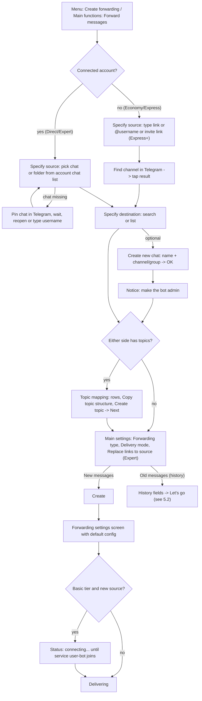
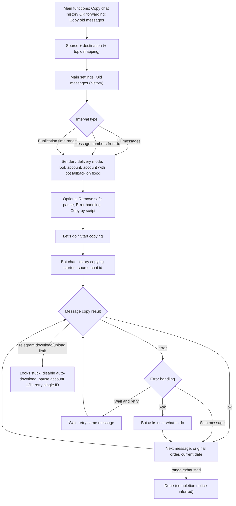
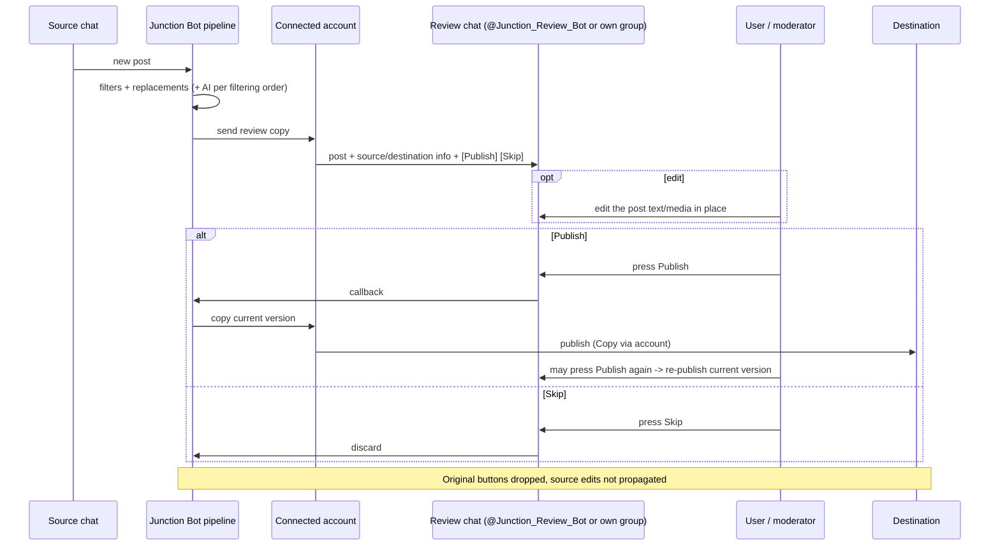
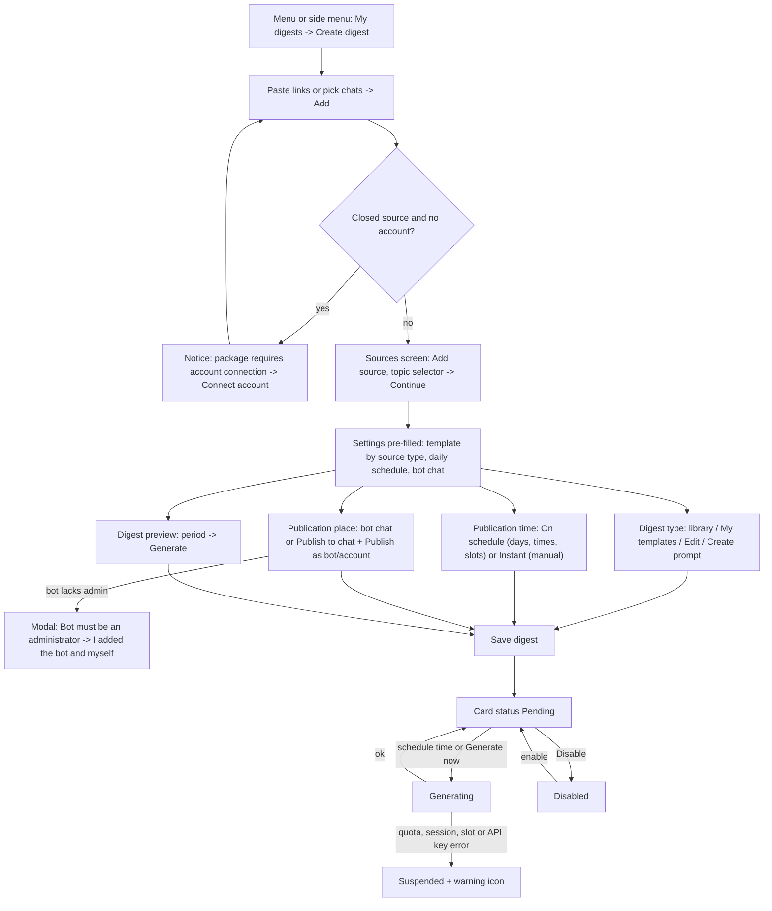

# Junction Bot — UX flows, screens and commands

How a user reaches and configures every feature of Junction Bot: entry points, commands, the screen tree with buttons, step-by-step flows, and the feedback/error patterns. Written for agents that cannot open the website.

- **Sources:** `pages/*.md` (51 translated pages, crawled 2026-11-19), with feature IDs from `features.md`. RU UI labels are given in parentheses, as the pages show them.
- **Tags:** **[doc]** = a page states it. **[inferred]** = our reconstruction (layout, ordering, labels seen only in screenshots, or logical gaps). Untagged structural text (headings, tables of contents) adds no claims.
- **Feature IDs:** `ACC-04` means `JB-ACC-04` in `features.md`. The `JB-` prefix is dropped in tables to save space.
- **Out of scope:** purchases, billing, prices, balance and promo codes. Plan tiers (Economy / Express / Direct / Expert, plus the "Advanced filters" add-on and the "Business" package) appear only as **capability gates**. A gate written "Direct+" means "needs a connected account (Direct or Expert)".

---

## 1. Entry points

### 1.1 Surfaces the user touches

| Surface | What it is | Used for | IDs |
|---|---|---|---|
| Chat with **@junction_bot** | Ordinary Telegram bot chat | Slash commands. Sending `@name` / invite links (own feed). The account-login dialog (phone + code). History-copy progress. System notifications and flood alerts. `/track` reports. Digests published "to Junction Bot chat". | CMD-*, TOP-09, ACC-02, HIST-06, DIAG-01, DIG-12 [doc] |
| **Mini-app** | Telegram Web App opened by the **Menu** button (the blue button left of the input field) | All configuration: forwardings, digests, projects, account | UI-01 [doc] |
| **Web app** (Веб-приложение) | The same mini-app opened in a normal browser window, from main menu → Web app | Desktop work, especially the table view | UI-08 [doc] |
| **Inline mode** | Type `@junction_bot <word>` in any chat | Search channels known to the bot | CMD-15 [doc] |
| **@Junction_Review_Bot** (chat shown as "Reviews") | Default moderation chat | Publish / Skip of held posts | MOD-01 [doc] |
| Own moderation group/channel | Chat the user picks | Team moderation | MOD-02 [doc] |
| **@junction_ctrl_bot** (Junction Bot Alerts) | Separate notification bot | Avoids losing system notifications that otherwise land in the main chat | DIAG-07 [doc] |
| **@junction_helper0_bot** | Helper bot | Forward it a message → it replies with that message's *source code* | DIAG-05 [doc] |
| **@junction_bro_bot** (Junction Bro) | AI help bot trained on the docs | Self-service Q&A | DIAG-10 [doc] |
| **@junction_support_bot** + a user group | Human support | Setup questions, account transfer | DIAG-10, ACC-09 [doc] |
| **Junction Bot Service Channel** | Channel the bot auto-creates on the *connected* account | Service messages. Must not be deleted (archiving is OK). | ACC-07 [doc] |
| Telegram's own UI | Native client | Pin a chat so it shows up in the pickers. Enable Topics. Set admin Anonymity. Manage scheduled ("Send later") posts. Look up a message link or ID. | UI-05, TOP-01, PUB-03, PUB-05, HIST-02 [doc] |

Deep link: marketing pages link to `https://t.me/junction_bot?start=docs-features-hero` [doc]. This implies `/start <payload>` carries an attribution tag [inferred].

### 1.2 Bot commands (full list)

Send these in the chat with @junction_bot. `<source_link>` is the link or @username of a source channel. A space *inside* one argument is written as `&nbsp;` [doc]. Commands that change settings address a forwarding by its **source link**, not by a forwarding ID [doc]. The docs do not say how such a command picks one forwarding when a source feeds several [inferred gap].

| Command | Arguments | Purpose | IDs |
|---|---|---|---|
| `/start` | optional deep-link payload | Opens the bot. After a plan is activated, the bot offers to create the first forwarding. | UI-01 [doc: the offer]; payload semantics [inferred] |
| `/track` | none. The bot then asks for a link to the source message. | Delivery-report wizard: delivered or not, why, plus the message source code. Also re-diagnoses and re-tunes the forwarding. | CMD-01, DIAG-01/02 [doc] |
| `/disableall` | — | Pause every forwarding | CMD-02, UI-12 [doc] |
| `/enableall` | — | Resume every forwarding | CMD-02 [doc] |
| `/dump` | — | Export all subscriptions, forwardings and settings as a file of bot commands | CMD-03, INT-02 [doc] |
| `/batch` | newline-separated commands after the first line | Run many commands at once (import). Only the *first* Telegram message is parsed, so split long lists into several `/batch` messages. | CMD-04, INT-03 [doc] |
| `/language` | then choose EN / RU | Change the UI language | CMD-05, INT-04 [doc] |
| `/filter <source_link>` | — | List all filters of that source | CMD-06 [doc] |
| `/filter <source_link> mustHave\|mustNotHave <text>` | text value | Add a text filter. Sending the same command again removes it (toggle). This also removes one source's copy of a global filter. | CMD-06, FLT-19 [doc] |
| `/filter <source_link> every <N>` | integer N | Forward only every N-th message | CMD-06, FLT-14 [doc] |
| `/filter <target_link> addAllFrom <source_link>` | two links | Copy all filters from one source to another | CMD-06, FLT-18 [doc] |
| `/filterall add\|remove mustHave\|mustNotHave <text>` | text | Add or remove a text filter on all *current* sources | CMD-07, FLT-19 [doc] |
| `/filterall DELETE ALL` | — | Delete every filter from every source | CMD-07 [doc] |
| `/filterrxall add\|remove mustHave\|mustNotHave <regex>` | regex | The same for regex filters, e.g. `add mustNotHave .*(http:\/\/\|https:\/\/).*` | CMD-08 [doc] |
| `/filtertime <source_link> mustHave\|mustNotHave <interval>` | `[w<days>] [H:MM-H:MM] [TZ]` | Date/time filter on one source | CMD-09, FLT-06 [doc] |
| `/filtertimeall add\|remove mustHave\|mustNotHave <interval>` | same | Date/time filter on all sources | CMD-10 [doc] |
| `/replace <source_link> <from> [<to>]` | `&nbsp;` for spaces. Omitted `<to>` = delete. | Plain replacement rule | CMD-11, PROC-05/07 [doc; grammar inferred from examples] |
| `/replacerx <source_link> <regex> [<to>]` | regex | Regex replacement rule | CMD-12, PROC-06 [doc] |
| `/setting author none\|name\|username\|full\|full_except_bot` | mode | Author display | CMD-13, PROC-13 [doc] |
| `/setting header none` | mode | Source-name header (only `none` is shown) | CMD-13, PROC-12 [doc] |
| `/setting mybuttons` + lines `<url> <label>` | multi-line | Own URL buttons | CMD-13, PROC-14 [doc] |
| `/setting like <word> <word> …` | words | Feedback buttons | CMD-13, PROC-15 [doc] |
| `/settingchannel <C> duplicate filter` | channel | Per-channel setting (the documented example is the duplicate filter) | CMD-14, FLT-15 [doc] |
| *(message)* `@channelname` or invite link | — | Subscribe that source into your own bot-chat feed | CMD-16, TOP-09 [doc] |
| *(inline)* `@junction_bot <word>` | word | Channel search | CMD-15 [doc] |

The docs show no target-forwarding argument for `/setting`. They also document no commands for projects, digests, moderation or AI [doc: absence].

### 1.3 Start and onboarding flow

1. The user opens @junction_bot (`/start`, possibly through a deep link) → bot chat with the **Menu** button [doc for the Menu button; greeting text unknown, inferred].
2. The user picks a plan (payment flow, out of scope). After activation, "the bot offers to create your first forwarding rule" [doc, getting-started].
3. **Direct/Expert only:** Menu → **Personal account (Личный кабинет)** → package card → **Connect account (Подключить аккаунт)** → leave the app and go to the bot chat → phone number → 5-digit code (see Flow F1) [doc, ACC-01/02].
   - The connection is also offered inline while creating a forwarding or digest: "You have a package that requires account connection to work" (У тебя есть пакет, для работы которого необходимо подключение аккаунта) → **Connect account** [doc].
4. Prepare the destination: invite @junction_bot into the target channel or group and make **both the bot and your account** admins (needed for "Copy via bot") [doc].
5. Menu → **Main functions → Forward messages (Основные функции → Пересылать сообщения)** or **Create forwarding (Создать пересылку)** → the wizard (Flow F4) [doc].
6. After **Create (Создать)** the user lands on the forwarding's **settings menu**. A default configuration is already applied and messages start flowing with no further setup [doc, UI-03].
7. Recommended follow-ups [doc]: add @junction_ctrl_bot for alerts; archive (do not delete) the Service Channel; never block the @junction_bot chat from the connected account; subscribe to the news channel.

Onboarding rules [doc]: Economy delivery is delayed (usually up to an hour). On Express the bot first needs a moment to "connect to sources", after which delivery is instant. Direct and Expert are instant.

### 1.4 Main menu (mini-app root)

Opened by the **Menu** button [doc, UI-01]. Items as named across the pages:

| Item (EN / RU) | Leads to | IDs |
|---|---|---|
| Main functions (Основные функции) → **Forward messages (Пересылать сообщения)** | Forwarding wizard (new messages) | UI-02 [doc] |
| Main functions → **Copy chat history (Копировать историю чата)** | Forwarding wizard preset for history | HIST-01 [doc] |
| **Create forwarding (Создать пересылку)** | Forwarding wizard. The instructions use this button. | UI-02 [doc] |
| **My forwardings (Мои пересылки)** | Forwardings list / table view | UI-06 [doc] |
| **My digests (Мои дайджесты)** | Digests list. Docs reach it from the main menu or the side menu. | DIG-01 [doc] |
| **Personal account (Личный кабинет)** / **My account (Мой аккаунт)** | Packages and connections. The two labels are used interchangeably. | UI-14 [doc] |
| **Web app (Веб-приложение)** | Opens the mini-app in a browser | UI-08 [doc] |
| **☰ side ("burger") menu** — top-right "3 bars" / "app menu icon" | Project switcher (All projects / each project), Manage projects, My digests, My account | PROJ-02, UI-01 [doc] |

The exact grouping and order of the root screen are visible only in screenshots [inferred].

---
## 2. Screen map

### 2.1 Tree

The tree layout follows the documented menu paths. Labels come from the pages. The nesting of screens the docs never place explicitly is marked [inferred].

```text
Telegram chat with @junction_bot
├── [Menu] button → MINI-APP
│   ├── Main menu (root)
│   │   ├── Main functions
│   │   │   ├── Forward messages ─────────────┐
│   │   │   └── Copy chat history ────────────┤
│   │   ├── Create forwarding ────────────────┤→ FORWARDING WIZARD
│   │   │                                      │    1 Specify source (Укажи источник)
│   │   │                                      │    2 Specify destination (Укажи назначение) [+ Create new chat]
│   │   │                                      │    3 Topic mapping (Сопоставление тем)   (skippable)
│   │   │                                      │    4 Main settings (Основные настройки)  → Create / Let's go / Start copying
│   │   ├── My forwardings ── list / TABLE VIEW (⚙ table settings, tabs)
│   │   │   └── <forwarding> ── FORWARDING SETTINGS SCREEN
│   │   │       ├── header: From (Откуда) ⚙ | To (Куда) ⚙   → Clone / Change source
│   │   │       ├── Copying new (Копирование новых) → Pause
│   │   │       ├── Copy old messages (Скопировать старые сообщения) → history Main settings
│   │   │       ├── Topic mapping
│   │   │       ├── Delivery mode
│   │   │       ├── Source info (Информация об источнике / Об источнике)
│   │   │       ├── Text processing (Обработка текста)
│   │   │       │   └── AI text processing → AI SCREEN (mode selector, prompts, prompt editor)
│   │   │       ├── Filtering (Фильтрация)
│   │   │       │   └── Keywords and stop words / Filters → FILTER LIST + editor
│   │   │       ├── Scheduling and publishing (Планирование и публикация)
│   │   │       ├── Images and video (Изображения и видео) / "Content" (Контент)
│   │   │       │   └── Watermarks → watermark picker [→ My watermarks → Create new watermark] [inferred link]
│   │   │       ├── Buttons (Кнопки)
│   │   │       ├── Other content (Прочий контент)
│   │   │       ├── Moderation (Модерация) → Moderation screen
│   │   │       ├── Debug settings (Отладочные настройки)
│   │   │       └── Delete (Удалить)
│   │   │   └── ⋮ on a list row → Move to project
│   │   ├── My digests ── DIGEST LIST (cards with status, ⋮ menu)
│   │   │   ├── Create digest → modal (paste links) → Sources screen → DIGEST SETTINGS SCREEN
│   │   │   │   ├── Digest type → template list (Template library / My templates) → TEMPLATE EDITOR
│   │   │   │   ├── Publication time
│   │   │   │   ├── Publication place
│   │   │   │   ├── Digest preview → Period → Generate
│   │   │   │   └── Save digest
│   │   │   └── card ⋮ → Disable | Copy with settings | Generate now | Move to project
│   │   ├── Personal account / My account
│   │   │   ├── package card → Connect account | 📝 edit → Change the number of the connected account
│   │   │   ├── phone row → Reconnect (Переподключить)
│   │   │   ├── Connect a new account (Подключение нового аккаунта)
│   │   │   └── number transfer (when a number is bound to another managing account)
│   │   └── Web app
│   └── ☰ side menu
│       ├── All projects (Все проекты) | Project #1 (Проект #1) | <other projects>
│       ├── Manage projects (Управление проектами) → list with counters, Create new project, ⋮ Edit → Delete project
│       ├── My digests
│       └── My account
├── chat messages: login dialog, "history copying started <id>", alerts, flood notices, /track wizard,
│   processing reports, own-feed posts, digests (default place)
└── commands (§1.2)

@Junction_Review_Bot chat "Reviews" ── held post + [Publish] [Skip]
Own moderation chat ─────────────────── held post + [Publish] [Skip]
```

### 2.2 Forwarding wizard screens

| Screen | Controls (EN / RU) | Behaviour | IDs |
|---|---|---|---|
| **Specify source (Укажи источник)** — without a connected account | Search field; **➤ Find channel in Telegram (➤ Найти канал в Telegram)**; result list | Type a public link or @username (Express+ also accepts an invite link) → Find → tap the result. If the source has no link, the user must connect an account. | FWD-03, FWD-02 [doc] |
| Specify source — with a connected account | List of all the account's chats: channels, groups, bots, private chats. **📁 folders** sit at the top with their composition (counts of channels / groups / personal chats). | Tap a chat or a folder. A missing chat → the pin workaround (UI-05). A new folder may take a couple of minutes to appear (refresh). | FWD-03, TOP-07 [doc] |
| **Specify destination (Укажи назначение)** | The same search or list; **Create new chat (Создать новый чат)** → name + type (channel / group) → **OK** | Bots appear only after you message them once. A newly created chat triggers the "make the bot admin" notice (see §4). | FWD-04, UI-04 [doc] |
| **Topic mapping (Сопоставление тем)** | Rows `source topic → destination topic`; default row "All topics → Main/General" (Из всех тем в Общую тему); **Copy topic structure (Скопировать структуру тем)** → **Let's go (Поехали)**; **Create topic (Создать тему)**; delete-row control; **Next (Далее)**. "Sync topics automatically" lives on the later edit screen. | Shown when either side has topics. Otherwise skipped. | TOP-01…04 [doc] |
| **Main settings (Основные настройки)** | **Forwarding type (Тип пересылки):** New messages (Новые сообщения) / Old messages (history) (Старые сообщения (история)); **Delivery mode (Режим доставки)**; **Replace links to the source (Заменять ссылки на источник)** (Expert; several variants seen only in screenshots); **Create (Создать)** | When "Old messages" is chosen, the history fields appear (next row) and the button becomes **Let's go / Start copying** [doc; the swap itself is inferred]. | UI-02, PUB-01, PROC-10 [doc] |
| Main settings — history fields | **Interval type (Тип интервала):** All messages / Message numbers (from–to) / Publication time; **Remove safe pause (Убрать безопасную паузу)**; **Error handling:** Ask / Skip message / Wait and retry; **Sender** (bot / account); **Copy by script (Копировать по сценарию)** checkbox; **Let's go (Поехали)** / **Start copying (Начать копирование)** | — | HIST-02…07 [doc] |

### 2.3 Forwardings list / table view (My forwardings)

| Control | Behaviour | IDs |
|---|---|---|
| Row click | Opens that forwarding's settings | UI-06 [doc] |
| Default columns | Source name, Destination name, Status | UI-06 [doc] |
| ⚙ table settings (top right) | Show/hide columns: source username/ID/type; phone of the account in the source; destination username/ID/type; phone of the publishing account; creation date; last settings update. Also **Place on tabs (Расположить на вкладках)**, **Place tabs vertically (Расположить вкладки вертикально)**, **Default settings (Настройки по умолчанию)**. | UI-06, UI-09 [doc] |
| Column header | Search filter field; sort arrows (multi-column); drag-and-drop reorder; resize | UI-06 [doc] |
| Tabs | First tab "All (Все)"; a count on each tab; tabs sorted by count | UI-06 [doc] |
| ⚙ display mode (mobile) | Compact (Компактный) / Wide (Широкий) / Auto (Авто) | UI-07 [doc] |
| ⋮ on an item | **Move to project (Переместить в проект)** | PROJ-03 [doc] |
| Persistence | The layout is remembered across sessions | UI-09 [doc] |

### 2.4 Forwarding settings screen (all settings, by group)

Path prefix: `Menu → My forwardings → <forwarding> →`. "Copy-only" means the setting needs a copy delivery mode (PROC-01).

| Group (EN / RU) | Setting (EN / RU) | Values / controls | Default | Gate / constraint | IDs |
|---|---|---|---|---|---|
| Header | **From (Откуда) ⚙** | Clone to another source (Клонировать на другой источник); Change source (Изменить источник) → expand list → pick chat and reader connection | — | — | UI-10, UI-11 [doc] |
| Header | **To (Куда) ⚙** | Clone to another destination [label inferred] | — | — | UI-10 [doc] |
| Copying new (Копирование новых) | Pause (Приостановить) / resume [inferred] | button | enabled | — | UI-12 [doc] |
| — | **Copy old messages (Скопировать старые сообщения)** | opens the history Main settings | — | Direct+ | HIST-08 [doc] |
| — | **Topic mapping** | mapping table; Copy topic structure; Create topic; **Sync topics automatically (Синхронизировать темы автоматически)** | All topics → Main | auto-sync: Expert | TOP-01…06 [doc] |
| — | **Delivery mode (Режим доставки)** | Copy via bot / Copy via account / Copy via account, on flood — via bot / Forward via account / Copy regular and forward forwards via account / Forward via account, on protection — copy | not stated (Copy via bot [inferred] on basic tiers) | account modes Direct+; flood fallback Expert | PUB-01 [doc] |
| Source info (Информация об источнике) | **Source name (Название источника)** | none / simple / bold / from_only / id / date / custom value | none | — | PROC-12 [doc] |
| Source info | **Author (Автор)** | none / name / username / full / full_except_bot | none [inferred] | — | PROC-13 [doc] |
| Source info | **Link to original post (Ссылка на оригинальный пост)** | none / full / custom value (Произвольное значение) | none | — | PROC-11 [doc] |
| Source info | **Replace cross-links with source (Заменять кросс-ссылки на источник)** | variants (screenshots only) | off [inferred] | Expert | PROC-10 [doc] |
| Text processing (Обработка текста) | **Add header (Добавлять заголовок)** | text/HTML | empty | copy-only | PROC-02 [doc] |
| Text processing | **Add text after message (Добавлять текст после сообщения)** | text/HTML | empty | copy-only | PROC-03 [doc] |
| Text processing | **Text trimming (Обрезка текста)** | integer; 0 = off | 0 [inferred] | copy-only | PROC-04 [doc] |
| Text processing | **Replace links and words in text (Замена ссылок и слов в тексте)** / "Replacements (Замены)" | list; **➕ Create new replacement (Создать новую замену)**; fields Source (Источник), New value (Новое значение); **RE** toggle; Edit (Редактирование) icon | empty | copy-only | PROC-05/06 [doc] |
| Text processing | **AI text processing (ИИ обработка текста)** / "AI processing (ChatGPT and others)" | AI screen (§2.5) | none | copy-only | AI-01 [doc] |
| Filtering (Фильтрация) | **Keywords and stop words (Ключевые и стоп-слова)** / "Filters (Фильтры)" | filter list + editor (§2.6) | empty | — | FLT-01…06, 10, 12 [doc] |
| Filtering | **Reactions filter (Фильтр по реакциям)**; the instruction calls it "Delay and delayed filter" (Задержка и отложенный фильтр) | From / To; condition (Min. reactions / views / forwards / replies, or ratios); "Repeat the check hourly…"; **Save (Сохранить)** | off | Advanced filters add-on or Business | FLT-07/08 [doc] |
| Filtering | **Filtering order (Порядок фильтрации)** | after reception / after replacements / after ai | not stated (after reception [inferred]) | — | FLT-09 [doc] |
| Filtering | **Filter my messages (Фильтр моих сообщений)** | pass / filter | pass | Direct+ | FLT-11 [doc] |
| Filtering | **Filter forwarded messages (Фильтровать пересланные сообщения)** / "Filter forwards" | all / direct only / forward only | all | — | FLT-13 [doc] |
| Filtering | **Duplicate filter (Фильтр дублей)** | pass / filter / only_duplicates | pass [inferred] | not with Forward via account | FLT-15 [doc] |
| Scheduling and publishing (Планирование и публикация) | **Forward edits (Передавать правки)** | edit / new / ignore | "enabled by default" | Direct+, copy-only | FWD-09 [doc] |
| Scheduling and publishing | **Forward deletions (Передавать удаления)** | yes / no | not stated | Direct+; a bot cannot delete messages older than 48 h | FWD-10 [doc] |
| Scheduling and publishing | **Delay (Задержать)** | From (fixed) / From + To (random) | off | — | PUB-04 [doc] |
| Scheduling and publishing | **Schedule ("deferred") (Запланировать ("отложка"))** | From / From + To | off | account delivery mode | PUB-05 [doc] |
| Scheduling and publishing | **Pin posts (Закреплять посты)** | off / pass / silent / notify | off [inferred] | notify works in groups only | PUB-07 [doc] |
| Scheduling and publishing | **Delivery frequency (Частота доставки)** | seconds; 0 = reset | 0 [inferred] | account delivery mode; counted per source | PUB-06 [doc] |
| Scheduling and publishing | **Silent mode (Тихий режим)** | pass / never / always | pass [inferred] | — | PUB-08 [doc] |
| Scheduling and publishing | **Save to Google Drive (Сохранять на Google Диск)** | Text only / Media only / Text and media; checkbox **Send nothing to destination** | off | file saving: not on the lowest tier | INT-01 [doc] |
| Images and video (Изображения и видео) / Content (Контент) | **Media caption (Подпись к медиа)** | separate / caption_name / text_only | not stated | — | PROC-16 [doc] |
| Images and video | **Watermarks (Водяные знаки)** | pick a watermark; Apply to image / video / animation | none | plan-dependent; copy-only | PROC-17 [doc] |
| Buttons (Кнопки) | **Copy buttons (Копировать кнопки)** | none / url / special / all | not stated | in account mode only with Premium | FWD-12 [doc] |
| Buttons | **Notification buttons (Кнопки с уведомлениями)** | none / `.*` / custom `<regex> [min-max] [body]` | none | Direct+; not when publishing as the account | FWD-13 [doc] |
| Buttons | **Add your own buttons (Добавить свои кнопки)** | none / custom lines `<url> <label>` | none | Copy via bot (or account + Premium) | PROC-14 [doc] |
| Buttons | **Feedback buttons (Кнопки обратной связи)** | none / 1 / 2 / custom words | none | Copy via bot only | PROC-15 [doc] |
| Other content (Прочий контент) | **Polls (Опросы)** | none / copy / custom link text | not stated | — | FWD-14 [doc] |
| Other content | **Stories (Истории)** | message / ignore | not stated | Expert | FWD-15 [doc] |
| Other content | **Comments (Комментарии)** | custom value = numeric ID of the source channel | none | Direct+ | FWD-16 [doc] |
| Other content | **Link preview (Предпросмотр ссылок)** | pass / never / always | pass [inferred] | — | PUB-09 [doc] |
| Moderation (Модерация) | **Moderation → Moderate messages (Модерировать сообщения)** | On/Off; **Select chat (Выбрать чат)**; **Send to @Junction_Review_Bot (Слать в @Junction_Review_Bot)**; **Save** | Off | plan-dependent; uses the connected account | MOD-01/02 [doc] |
| Debug settings (Отладочные настройки) | **Flood reaction (Реакция на флуд)** | Ignore message / Stop forwarding completely / Postpone and deliver when possible / Notify on flood ban | Postpone | — | PUB-10 [doc] |
| Debug settings | **Processing report (Отчет об обработке)** | ON/OFF | OFF | — | DIAG-03 [doc] |
| — | **Delete (Удалить)** | button. Irreversible. | — | — | UI-13 [doc] |

The order of the groups on screen follows the docs' listing. The real order is visible only in screenshots [inferred]. Instructions often say "scroll down and find X", which suggests one long scrollable screen with group headers [inferred].

### 2.5 AI text-processing screen

| Element (EN / RU) | Behaviour | IDs |
|---|---|---|
| **Mode selector** (top of the page): Free mode (Бесплатный режим) / Pay from balance (Оплата с баланса) / Use your own API key (Использовать свой API ключ) → OpenAI or OpenRouter, plus a key field | **Global** for all forwardings, digests and AI services. The same selector appears on the digests screen. | AI-05 [doc] |
| **Active prompt (Активный промпт)** block | The prompt now working on this forwarding. Hidden when there is none. | AI-02 [doc] |
| **My prompts (Мои промпты)** + **+ Create prompt (+ Создать промпт)** | Prompts the user created or edited | AI-02/04 [doc] |
| **Prompt library (Библиотека промптов)** | Templates, e.g. "Ad check (Проверка на рекламу)" and "Potential client detection (Определение потенциального клиента)" | AI-02/08/09 [doc] |
| Tap a prompt → **Apply (Применить)** (bottom of the screen) | The prompt moves into Active prompt | AI-03 [doc] |
| ⋮ on a prompt | **Edit (Редактировать)** / **Copy (Скопировать)** / **Stop (Остановить)**. Stop deactivates the prompt and returns it to its list. | AI-03 [doc] |
| **Prompt editor** | Name (Название), Description (Описание), Prompt text (Текст промпта), Creativity (Креативность, recommended 0.7), Model (Модель) in paid or own-key modes; **Save and apply (Сохранить и применить)** / **Save (Сохранить)** | AI-04/06 [doc] |

### 2.6 Filter list and editor (Keywords and stop words)

| Element | Behaviour | IDs |
|---|---|---|
| List rows | First-column icon: green = allowing (mustHave), red = blocking (mustNotHave) | FLT-02 [doc] |
| Type selector (bottom of the screen) | By text match (По текстовому совпадению) / By regular expression (По регулярному выражению) / By word forms (По словоформам) / By date/time (По дате/времени) / By author (По автору) | FLT-03…06, 10 [doc] |
| **+** | New filter of the selected type → **Value (Значение)** field + left checkbox (ticked = allowing, "Pass matching messages (Пропускать подходящие сообщения)"; unticked = blocking, "Stop matching messages (Останавливать подходящие сообщения)") → Save | FLT-01/02 [doc] |
| Bulk import button | Import many filters from a table (format not documented) | FLT-17 [doc] |
| Edit / delete row | Most convenient in this screen [doc]; the controls are visible only in screenshots [inferred] | FLT-01 |

### 2.7 Watermark screens

| Screen | Controls | IDs |
|---|---|---|
| Forwarding → Images and video → **Watermarks** | Pick from previously uploaded watermarks; checkboxes **Apply to image (Накладывать на изображение)**, **Apply to video (Накладывать на видео)**, **Apply to animation (Накладывать на анимацию)** | PROC-17 [doc] |
| **My watermarks (Мои водяные знаки)** → **Create new watermark (Создать новый знак)** | Name; Watermark file (PNG only); Opacity level (higher = more transparent); **Scaling (Масштабирование):** Fit (proportional) (Вместить), Cover (proportional) (Покрыть), Do not scale (Не масштабировать); **Alignment (Выравнивание):** center / a side / a corner / Random (Случайное) | PROC-18 [doc]. Where "My watermarks" is opened from (probably the watermark picker) [inferred]. |

### 2.8 Moderation screen and review chat

| Element | Behaviour | IDs |
|---|---|---|
| **Moderate messages (Модерировать сообщения)** On/Off | Enabling forces Copy via account [doc] | MOD-01/04 |
| **Select chat (Выбрать чат)** | Pick an existing group/channel or create a new one; it is then shown on the page → **Save** | MOD-02 [doc] |
| **Send to @Junction_Review_Bot** | Return to the default review chat | MOD-02 [doc] |
| Review message (in "Reviews" or your chat) | A copy of the post, sent by your connected account, with source/destination info and **Publish (Опубликовать)** / **Skip (Пропустить)**. Editable in place because your account sent it. Publish can be pressed repeatedly; each press publishes the current version. | MOD-01/03 [doc] |

### 2.9 Digest screens

| Screen | Controls (EN / RU) | IDs |
|---|---|---|
| **My digests (Мои дайджесты)** list | Cards showing a status (Pending / Generating / Disabled / Suspended + ⚠️); **Create digest (Создать дайджест)**; ⋮ → **Disable (Отключить)** / enable, **Copy with settings**, **Generate now (Сгенерировать сейчас)**, **Move to project** | DIG-14/15 [doc] |
| Create-digest modal | Paste one or more links → **Add (Добавить)**. With an account: pick from the chat list → Add. | DIG-02/09 [doc] |
| **Sources (Источники)** screen | Source list; **Add source (Добавить источник)**; topic selector for forum groups (**All topics (Все темы)** or individual topics); the "Connect account" prompt for closed sources; **Continue (Продолжить)** | DIG-09/10 [doc] |
| **Digest settings** screen | **Digest type (Тип дайджеста)**, **Publication time (Время публикации)**, **Publication place (Место публикации)**, **Digest preview (Предпросмотр дайджеста)**, **Save digest (Сохранить дайджест)**. The instruction labels the save button "Create digest". | DIG-01 [doc] |
| Digest type → template list | **Template library (Библиотека шаблонов)**: News overview (Новостной обзор), Group discussions (Обсуждения в группе); **My templates (Мои шаблоны)**; **Edit (Редактировать)**; **Create prompt (Создать промпт)**; **Example (Пример)** | DIG-05 [doc] |
| Template editor | Prompt text (Текст промпта); Model (Модель), locked in free mode; Temperature (Температура) 0–2 in steps of 0.1, default 0.7; **Consider past digests (Учитывать прошлые дайджесты)** 0–10 (free mode max 1); Preview in place; **Save and apply** | DIG-06/07 [doc] |
| Publication time | **On schedule (По расписанию)** / **Instant digest (manual) (Мгновенный дайджест (вручную))**; **At the same time (В одно и то же время)** checkbox for all 7 days; per-day hours; **+** adds slots. "On schedule" is disabled when no slots remain. | DIG-03/11 [doc] |
| Publication place | **Publish to Junction Bot chat (Публиковать в чат Junction Bot)** (default) / **Publish to chat (Публиковать в чат)** → pick a chat → **Publish as (Публиковать от имени)**: bot / connected account. Rights-check dialog: "Bot must be an administrator (Бот должен быть администратором)" → **I added the bot and myself as admins (Я добавил бота и себя в админы)**. | DIG-12 [doc] |
| Preview | **Period**: For a week (За неделю) / Since last generation (С последней генерации) → **Generate (Сгенерировать)**. A Telegram-styled window shows the result plus usage (generations spent, or input/output tokens with your own key). | DIG-13 [doc] |

### 2.10 Projects screens

| Screen | Controls | IDs |
|---|---|---|
| ☰ side menu | **All projects (Все проекты)**, each project (default **Project #1 (Проект #1)**), **Manage projects (Управление проектами)** | PROJ-02 [doc] |
| Manage projects | List with forwarding and digest counters; **Create new project** → name → save; ⋮ → **Edit (Редактировать)** (rename); ⋮ → Edit → **Delete project (Удалить проект)** (empty projects only) | PROJ-04 [doc] |
| Move dialog (from ⋮ on a forwarding/digest) | Project list → **Select (Выбрать)**; **+ Create new project (+ Создать новый проект)** inline | PROJ-03 [doc] |

### 2.11 Personal account (functional parts only)

| Element | Behaviour | IDs |
|---|---|---|
| Package cards | Show the active packages. Billing parts are excluded. | UI-14 [doc] |
| **Connect account (Подключить аккаунт)** on a Direct/Expert card | Starts the login dialog in the bot chat | ACC-01 [doc] |
| **Reconnect (Переподключить)** next to a phone number | Re-authorises a broken session | ACC-06 [doc] |
| 📝 / "Edit (Редактирование)" icon on a card → **Change the number of the connected account (Поменять номер подключенного аккаунта)** | New number → code | ACC-05 [doc] |
| 📝 → "Change number of packages" | A purchase step (out of scope). It is the prerequisite for an extra connection. | ACC-04 [doc] |
| **Connect a new account (Подключение нового аккаунта)** | Second and further connections | ACC-04 [doc] |
| Number transfer | Shown when a number is already bound under another managing account | ACC-09 [doc] |

---
## 3. Step-by-step flows

Format: **user action → bot response / screen**. All flows start in the chat with @junction_bot unless stated. "Menu" means the mini-app opened by the Menu button.

### A. Accounts

#### F1. Connect an account (Direct/Expert) — ACC-01, ACC-02
1. Menu → **Personal account** → find the Direct/Expert package card → **Connect account** → the mini-app says to leave the app and go to the bot chat [doc]. The same entry point is offered inline in the forwarding or digest wizard when a closed source needs it [doc].
2. In the bot chat a message about activating the direct connection arrives → the user sends the phone number, starting with `+` [doc].
3. Telegram sends a **5-digit login code** into the official Telegram service chat. It is *not* an SMS, and the chat may not jump to the top [doc] → the user types the code into the bot chat [doc].
4. On success the bot confirms the connection [doc; wording unknown] → the account's chats appear in the source/destination pickers of forwardings and digests [doc]. Telegram may warn about a "new/unknown device"; this is expected [doc, ACC-10]. The bot creates **Junction Bot Service Channel** on that account [doc, ACC-07].
5. 2FA (cloud password) handling is not documented. A password prompt after the code is likely [inferred].
- Failure "code does not arrive" → check the Telegram service chat, wait a few minutes, check whether the number is already bound under another managing account (then transfer it from that account's Personal account) [doc].

#### F2. Change the connected account's number — ACC-05
1. Menu → app menu icon (☰) → **My account** → the edit icon (📝 "Edit") on the package card [doc].
2. **Change the number of the connected account** → enter the new number with `+` → **OK** [doc].
3. The bot asks for the code Telegram sent to the new number → enter it → connected [doc].
- Gate: only on connected-account tiers. Repeated changes are restricted (billing details out of scope) [doc]. The effect on existing forwardings bound to the old number is not documented [inferred: they move to the new session].

#### F3. Split forwardings across two accounts — ACC-04, UI-11
1. Menu → ☰ → **My account** → 📝 Edit → Change number of packages → increase → OK → (purchase step, out of scope) → My account shows 2 active packages [doc].
2. **Connect a new account (Подключение нового аккаунта)** → message "go to the chat with Junction Bot" → in the bot chat, a "direct connection activation" message → send the second phone number → code → "connection succeeded" [doc].
3. In Telegram, add the new account to the source chat. It must be a member [doc].
4. Menu → open the forwarding → **gear ⚙ right of From (Откуда)** → **Change source (Изменить источник)** → expand the list → select the new connection (and the chat) [doc].
5. Repeat for the other forwardings you want moved. In the table view, group the tabs by "Source account phone" to check the split [doc, UI-06].

### B. Creating forwardings

#### F4. Create a forwarding from a public source (link / @username) — FWD-03, UI-02
Pre-step: create the destination if needed and add @junction_bot as admin (any rights) [doc].
1. Menu → **Create forwarding** (or Main functions → Forward messages) → **Specify source** [doc].
2. Type the public link, `@username` or (Express+) invite link → **Find channel in Telegram** → the bot shows the channel name → tap it [doc]. If the source has no link, the bot directs you to connect an account [doc].
3. **Specify destination** → type the link or @username → Find → tap the result. Optional: **Create new chat** → name + channel/group → OK [doc].
4. **Topic mapping**: shown only if either side has topics. Configure it or skip [doc].
5. **Main settings** → Forwarding type **New messages**; **Delivery mode** (copy/forward, bot/account); optional **Replace links to the source** (Expert) → **Create** [doc].
6. → Forwarding settings screen with the default config. On basic tiers the status may show **connecting…** until the service user-bot has joined the source [doc, ACC-08].
- If the destination was just created, a notice says the bot must be an admin. It disappears on scroll. Pressing **Create** shows it again with options to choose from (options visible only in screenshots) [doc].

#### F5. Create a forwarding from a private / closed source — FWD-02, ACC-01
1. Make sure an account is connected (F1) and is a member of the source [doc].
2. Menu → **Create forwarding** → the list of all the account's chats (channels, groups, bots, DMs; 📁 folders on top) → tap the source. If it is not listed: close the mini-app, **pin** the chat in Telegram, wait a few minutes, reopen. Or type the username [doc, UI-05].
3. Pick the destination from the list (or Create new chat). For a bot destination, message that bot once first [doc].
4. Topic mapping → Main settings (New messages, delivery mode, link auto-replacement) → **Create** [doc].
- Express+: a private source *with a working invite link* can be added without an account through the search box (F4 step 2) [doc]. Delivery holds only while the link works and the service user-bot is not banned [doc].

#### F6. Use a Telegram folder as the source — TOP-07, TOP-08
1. In Telegram, create a chat folder on the connected account and add the chats explicitly. "Include all channels"-style rules are ignored [doc].
2. Menu → Create forwarding → the 📁 folder appears at the top of the source list with its composition (N channels, N groups, N personal chats). If it is missing, wait a couple of minutes and refresh [doc].
3. Destination → topic mapping → Main settings → Create [doc].
4. Later edits to the folder's membership apply automatically. Filters on this forwarding apply to every chat in the folder [doc]. If chat A is in the folder *and* has its own forwarding, each A message is sent once, using the direct forwarding's settings [doc].

#### F7. Own feed in the bot chat (no wizard) — TOP-09, CMD-16
1. In the bot chat, send a public `@channelname` (no membership needed) or a private invite link [doc].
2. You are subscribed. New posts appear in the bot chat [doc]. Confirmation wording is unknown [inferred]. Subscriptions are included in `/dump` [doc].

#### F8. Map topics between forum groups — TOP-01, TOP-02
1. Telegram: in the destination group, **Manage group → Group settings → Topics: ON**. Create topics (a new topic needs one message to finish creation) [doc].
2. Menu → Create forwarding → source group → destination group [doc].
3. **Topic mapping** screen: the default row "From all topics to the General topic" is present (deletable) [doc].
4. Add a row: pick source topic `topic_1` → destination topic `topic_1_1`. Once an explicit row exists, the default row turns into **All other topics → General** [doc]. Keep it so that topics created later still flow to General, or delete it [doc].
5. Optional **Create topic** to make a destination topic in place [doc].
6. **Next** → Main settings → New messages → **Create** [doc].
- Variants [doc]: a destination without topics (or a channel) is offered "All topics → destination", or only selected topics. Many sources into different topics: create one forwarding per source and pick the target topic in each.

#### F9. Copy the topic structure — TOP-03, TOP-06
1. Prepare the destination group with Topics ON (no topics needed) [doc].
2. Create forwarding → source forum group → destination group → Topic mapping [doc].
3. **Copy topic structure** → **Let's go** → the bot creates same-named topics in the destination and maps them 1:1. Its first row is "All other topics → General" [doc].
4. **Next** → Main settings → Create [doc].
5. Optional, Expert: later open Menu → My forwardings → forwarding → Topic mapping → tick **Sync topics automatically**. New source topics are created in the destination and renames propagate. Deletions are not synced. Sources must be forum groups (not folders or DMs) [doc].

#### F10. Clone a forwarding — UI-10
1. Menu → open the forwarding → gear icons next to **From** and **To** [doc].
2. Clone to a new source: the source-side gear → **Clone to another source (Клонировать на другой источник)** → pick the new source → done. The clone keeps all settings [doc]. The instruction says to tap the **To** gear here, which is probably a doc error; From is expected [inferred].
3. Clone to a new destination: the destination-side gear → clone option (label in screenshot) → pick the new destination → done [doc].
- The clone is a new forwarding and counts toward the plan's forwarding limit [inferred].

#### F11. Pause, delete, disable all — UI-12, UI-13, CMD-02
1. Pause: Menu → forwarding → **Copying new (Копирование новых)** → **Pause (Приостановить)**. Settings are kept. Resume from the same place [doc; the resume label is inferred].
2. Delete: Menu → forwarding → **Delete (Удалить)**. Irreversible: settings and filters are lost [doc]. A confirmation dialog is likely [inferred]. Back up first with `/dump` [inferred].
3. All at once: send `/disableall` / `/enableall` [doc].

### C. Filters

#### F12. Text / keyword filter — FLT-03
1. Menu → forwarding → **Filtering → Keywords and stop words** (also labelled "Filters") [doc].
2. At the bottom choose **By text match** → **+** → **Value** = e.g. `Bitcoin` → tick the left checkbox for allowing (mustHave) or leave it unticked for blocking (mustNotHave) → Save [doc].
3. The row appears with a green (allowing) or red (blocking) icon [doc].
- Rules [doc]: case-sensitive; a multi-word value must occur contiguously. Same-type allowing filters are OR'ed; any blocking hit stops the message; different types are AND'ed.
- Command alternative: `/filter <src> mustHave Bitcoin` (send it again to remove) [doc].

#### F13. Regex filter — FLT-04, DIAG-06
1. Same screen → **By regular expression** → **+** → Value, e.g. `(?i:.*bitcoin.*|.*ethereum.*)` → allowing/blocking → Save [doc].
2. Always end the pattern with `.*`, because the bot may append a space or a media token [doc].
3. Debug on regex101: flavor Java 8, flags "Single line" + "Global". Get the sample text from `/track` [doc].
- All sources at once: `/filterrxall add mustNotHave .*(http:\/\/|https:\/\/).*` [doc].

#### F14. Word-form filter — FLT-05
1. Requires the "Advanced filters" add-on or the Business package. Without it the filter is silently ignored [doc].
2. Keywords and stop words → **By word forms** → **+** → one word in any form (e.g. `ищу`) → allowing/blocking → Save [doc]. A phrase uses only its first word. RU/EN/UK/DE, case-insensitive [doc].
- Manual alternative: several regex filters `\bзаявка\b`, `\bзаявки\b`, … (bulk import helps) [doc].

#### F15. Date/time filter — FLT-06
1. Keywords and stop words → **By date/time** → **+** → Value `w12345 8:00-20:00 Europe/Moscow` → allowing → Save [doc].
2. Cross-midnight windows: one blocking day-part filter (`3:00-16:59 Europe/Moscow`) or two allowing ones [doc]. If the start is not before the end, the bot shows an error [doc].
3. Out-of-window messages are **dropped**, not queued. To publish later, use Delay or Schedule instead [doc].
- Commands: `/filtertime <src> mustHave …`, `/filtertimeall add mustNotHave 0:00-7:00 Europe/Berlin` [doc].

#### F16. Author filter — FLT-10
1. By ID: Keywords and stop words → **By author** → **+** → numeric ID (anonymous admin = the chat ID without `-100`) → allowing/blocking → Save [doc].
2. By name: Source info → **Author** = name/full → then a **By text match** filter with the name [doc].
3. To hide the name after filtering: route A → C (author on + name filter) → B, and on C→B add a replacement `@user (Name)` → empty. A replacement on A→C would not touch the author line, because it is service text [doc].

#### F17. Media-type filter — FLT-12
1. Filtering → Filters → **+** → By text match → Value = a token: `<photo>` `<document>` `<audio>` `<video>` `<sticker>` `<voice>` `<location>` `<animation>` `<videonote>` `<poll>` [doc].
2. Ticked = only messages containing that media pass (with or without text). Unticked = that media is blocked [doc].
- "Only photos/videos, no text": Media caption = `separate` + allowing `<photo>` and `<video>` [doc]. "Only text": Media caption = `text_only` [doc].

#### F18. Forwarded / own / duplicate / every-N filters — FLT-11, FLT-13, FLT-14, FLT-15
1. **Filter forwarded messages**: all → direct only (the author's own posts) or forward only [doc].
2. **Filter my messages**: pass → filter, to hide what the connected account itself wrote (Direct+) [doc].
3. **Duplicate filter**: pass → filter (drop repeats among the last 300 source messages; memory resets after 24 h of silence) or only_duplicates (an AND of two sources through an intermediate channel) [doc]. Not available with Forward via account [doc]. The command form is `/settingchannel <C> duplicate filter` [doc].
4. **Every N-th**: send `/filter <src> every 2` (command only) [doc].

#### F19. Delayed (engagement) filter — FLT-07, FLT-08
1. Requires the Advanced filters add-on or Business [doc].
2. Menu → forwarding → **Delay and delayed filter** (docs: Filtering → **Reactions filter**, or Scheduling and publishing → **Delay**) [doc].
3. Set the window **From** (e.g. 3 h) and optionally **To** (6 h) [doc].
4. **Delayed filter**: pick a condition (Min. reactions / Min. views / Min. forwards / Min. replies, or the ratio variants Min. reactions / forwards / replies to views) and a value (e.g. 1, or 0.1 for 1 per 10 views) [doc].
5. Optional: tick **Repeat the check hourly throughout the period** [doc] → **Save** [doc].
6. Runtime [doc]: a post published at 14:00 is checked at 17:00 and published if the threshold is met; otherwise checked again at 20:00, else dropped. With the hourly option there are extra checks at 18:00 and 19:00.

#### F20. Filtering order — FLT-09
1. Menu → forwarding → Filtering → **Filtering order** → `after reception` (Filters → Replacements → AI) / `after replacements` (Replacements → Filters → AI) / `after ai` (Replacements → AI → Filters) [doc].

#### F21. Bulk filter operations — FLT-17, FLT-18, FLT-19
1. Bulk import: the button on Keywords and stop words → upload or paste a table (format undocumented) [doc].
2. Copy filters: `/filter <target> addAllFrom <source>` [doc]. Cloning also carries the filters [doc].
3. Global: `/filterall add|remove …`, `/filterrxall …`, `/filtertimeall …`. These affect only *current* sources; new forwardings start with no filters [doc]. Wipe everything: `/filterall DELETE ALL` [doc].
4. Inspect: `/filter <src>` lists the filters [doc].

#### F22. Debug a filter — DIAG-01…05
1. Copy the link of the source message that did not arrive (right-click → Copy message link) [doc].
2. Send `/track` → the bot asks for the link → paste it [doc].
3. The bot replies with a **delivery report**: delivered or not, which filter or setting stopped it, the detected content type, and the source code [doc]. See F53–F55.
4. If still unclear: forwarding → Debug settings → **Processing report: ON** → wait for the next source message → a per-message report arrives along with it [doc].
5. Alternative way to get the source code: forward the message to @junction_helper0_bot [doc].
6. Support request kit: the delivery report including the source code [doc].

### D. Text and message processing

All of these require a **copy** delivery mode; native forward cannot be modified [doc, PROC-01].

#### F23. Replacements — PROC-05, PROC-06
1. Menu → forwarding → Text processing → **Replace links and words in text** ("Replacements") → **➕ Create new replacement** [doc].
2. **Source (Источник)** = the text to find; **New value (Новое значение)** = the replacement (empty = delete); toggle **RE** for a regex (`$1` backreferences, `(?s)` for multi-line) → save [doc].
3. Edit later with the **Edit** icon. New rules are always appended to the end and there is no reordering, so to "move" a rule, delete and re-create it [doc]. Put longer rules before shorter ones [doc].
4. Before writing rules, look at the message **source code** (`/track`, processing report, @junction_helper0_bot), because rules match the HTML form (`<a href…>`, `<b>`, `<br>`, `<strong documentid=…>`) [doc].
- Command forms: `/replace <src> <from> [<to>]`, `/replacerx <src> <regex> [<to>]` [doc].
- Scope [doc]: message body and buttons (including the pop-up text of notification buttons). Not the source name, author line or link-to-original.

#### F24. Header, footer, trimming — PROC-02…04
1. Text processing → **Add header**: text/HTML. End it with a line break if the original should start on a new line [doc].
2. Text processing → **Add text after message**: start with `<br>` or a newline to put it on its own line [doc].
3. Text processing → **Text trimming**: N characters (150–1000 recommended; 0 = off) [doc].

#### F25. Author, source name, link to original — PROC-11…13
1. Source info → **Author** → none / name / username / full / full_except_bot. The name is hyperlinked to the profile and may appear as `User#123456` when the profile is unavailable [doc]. Command: `/setting author full` [doc].
2. Source info → **Source name** ("Source name: none") → simple / bold / from_only / id / date / custom HTML [doc]. Broken HTML in a custom value makes messages stop arriving or arrive unformatted [doc]. Command: `/setting header none` [doc].
3. Source info → **Link to original post** ("none" by default) → **full**, or type a **Custom value** such as "не ходи сюда" to hide the link under that text [doc].
- Alternative that keeps the author natively: delivery mode **Forward via account** [doc].

#### F26. Media caption — PROC-16, FWD-17
1. Images and video (or "Content") → **Media caption** → `separate` (media + text as 2 messages, so long captions arrive whole), `caption_name` (1 message with name + link; truncated if too long), `text_only` (drop the media) [doc].
- Symptom "messages arrive without pictures" → set `caption_name` [doc].

#### F27. Watermarks — PROC-17, PROC-18
1. Create a preset: **My watermarks** → **Create new watermark** → Name → upload a PNG → Opacity → Scaling (Fit / Cover / Do not scale) → Alignment (center / side / corner / Random) → save [doc].
2. Apply: Menu → forwarding → Images and video → **Watermarks** → pick the preset → tick Apply to image / video / animation [doc]. The save action is not described [inferred: it auto-saves or has a Save button].
- Plan-dependent. Copy mode only [doc].

#### F28. Buttons — FWD-12, FWD-13, PROC-14, PROC-15
1. Buttons → **Copy buttons** → none / url / special / all. Only URL buttons work after copying [doc].
2. Buttons → **Notification buttons** → `.*` or custom `<regex> <min>-<max> [body]` (e.g. `.* 15-300 body` puts the pop-up text into the post body after a random 15–300 s press delay) [doc].
3. Buttons → **Add your own buttons** → custom value: one `<url> <label>` per line [doc]. Command: `/setting mybuttons` + lines [doc].
4. Buttons → **Feedback buttons** → 1 / 2 / custom words [doc]. Command: `/setting like Да Нет Возможно` [doc].
- Delivery-mode constraints [doc]: native buttons only with **Copy via bot**. Account copy modes show link buttons only with Premium (rich text). Forward via account shows none. Feedback buttons work only with Copy via bot. Moderation drops the original buttons.

#### F29. Other content — FWD-14, FWD-15, FWD-16, PUB-09
1. Other content → **Polls**: none / copy / custom text (puts a link to the original poll under that text) [doc].
2. Other content → **Stories** (Expert): message / ignore [doc].
3. Other content → **Link preview**: pass / never / always [doc].
4. **Comments** (Direct+) [doc]:
   a. Find the discussion group: channel ⋮ → **View discussion (Посмотреть обсуждение)**. Join it with the *connected* account and stay.
   b. As separate posts: create a forwarding from the discussion group to any destination.
   c. As comments: forwarding 1 = source channel → destination channel (plain). Forwarding 2 = source discussion group → destination discussion group, with the bot as admin there. In forwarding 2 open Other content → **Comments** → enter the **source channel's** numeric ID (e.g. `2015095027`).
   d. For comments to appear "as the group", use account delivery + admin Anonymity. This works only for posts published after setup.

#### F30. Third-party bot and intermediate-channel recipes — PROC-19, FWD-20
1. External bot processing: forwarding source → @thirdpartybot (account mode), then forwarding @thirdpartybot → destination [doc].
2. Several sources through one bot: Add header `ИСТОЧНИК1` on each source→bot rule → bot → intermediate channel with an allowing text filter `ИСТОЧНИК1` → intermediate → destination with a replacement `ИСТОЧНИК1` → empty [doc].
3. Apply a setting to a subset only: A→C with an allowing filter, A→D with the same filter blocking, C→B with the extra setting (e.g. own buttons), D→B plain [doc].
4. Dedup after replacements: A→C with the replacements, C→B with the duplicate filter, and the bot as admin of B [doc].

### E. AI

#### F31. Set up AI processing with a library prompt — AI-01…03
1. Menu → forwarding → check that **Delivery mode** is a copy mode [doc].
2. Scroll to **AI processing (ChatGPT and others)** / Text processing → AI text processing [doc].
3. Optional: choose the global **AI mode** at the top: Free / Pay from balance / Own API key (OpenAI or OpenRouter) → paste the key [doc]. The change affects *all* forwardings and digests [doc].
4. In the **Prompt library**, tap a prompt → **Apply** → it moves to **Active prompt** and starts working [doc].
5. To adapt it: ⋮ → **Edit** → change the text → **Save** (a copy goes to My prompts) or **Save and apply** (the copy becomes active). The library original stays unchanged [doc].
6. To stop: ⋮ on the active prompt → **Stop**. It returns to its list [doc].
- Sharing [doc]: one prompt can be active on several forwardings, and editing it changes all of them.

#### F32. Create your own prompt — AI-04, AI-06
1. AI screen → My prompts → **+ Create prompt** [doc].
2. Fill **Name** ("Tech hashtags"), **Description**, **Prompt text** ("Analyze the text. If it is about technology … add #ai, #startup, #crypto"), **Creativity** 0.7, and **Model** (paid or own-key modes only; free mode has one model) [doc].
3. **Save and apply** → active on this forwarding; or **Save** → it stays in My prompts for later [doc].

#### F33. Preset: AI ad removal — AI-08, FLT-16
1. Forwarding → AI processing → library **Ad check (Проверка на рекламу)** → Apply [doc].
2. Filtering → Keywords and stop words → By text match → **blocking** filter `РЕКЛАМА` (the marker written by the prompt) → Save [doc]. The filters doc variant edits the prompt to output `ПРОПУСК` and blocks that word instead [doc].
3. Filtering → **Filtering order** → `after ai` [doc].
4. Delivery mode `copy_client` (Copy via account) or `copy_bot` (Copy via bot) [doc].

#### F34. Preset: lead detection — AI-09
1. Create a forwarding from the chats to monitor into a "leads" chat (F4/F5) [doc].
2. AI processing → library **Potential client detection** → **Edit** to fit your business → **Apply** [doc].
3. Blocking text filter `НЕ_ЛИД` → Save → Filtering order `after ai` → copy delivery mode [doc].
4. Optional: Link to original = **full**, Author = **username/full**, so each lead is clickable [doc].

### F. Publishing and moderation

#### F35. Moderation via @Junction_Review_Bot — MOD-01, MOD-03, MOD-04
1. Menu → forwarding → **Moderation** → row **Moderate messages** → **On** [doc]. The delivery mode switches to Copy via account automatically. The account needs posting rights in the destination [doc].
2. A new post appears in the source → filters and replacements run → the *connected account* sends a copy to **@Junction_Review_Bot**. The chat "Reviews" pops to the top of the chat list on the first item [doc].
3. The held post shows source/destination info and **Publish** / **Skip** [doc].
4. Optional: edit the post in place (it is your own message) [doc].
5. **Publish** → posted to the destination. Pressing again posts the current version again [doc]. **Skip** → discarded [doc].
- Side effects [doc]: original buttons are not passed and source edits are not propagated. Timeouts for unreviewed items are not documented.

#### F36. Moderation via your own chat — MOD-02
1. Moderation → Moderate messages **On** → **Select chat** → pick a prepared group/channel or create one → it is shown on the page → **Save** → "settings saved" [doc].
2. In Telegram, add **@Junction_Review_Bot** (and keep the connected account) as **admins** of that chat. Otherwise the error is `NO_ACCESS` [doc]. The instruction also says "the bot must be admin" [doc; probably the same requirement].
3. Posts arrive there with Publish / Skip. Any admin present can act, which enables team moderation [inferred from MOD-05].
4. Revert: **Send to @Junction_Review_Bot** [doc].

#### F37. Choose the delivery mode and sender — PUB-01, PUB-02, PUB-03
1. Menu → forwarding → **Delivery mode** → choose one of the 6 modes (see `architecture.md` §4.6) [doc].
2. As bot: make @junction_bot *and* yourself (or one of your connected accounts) admins of the destination, with the bot allowed to post [doc]. As account: the account only needs posting rights [doc].
3. "Posts come from the bot but I want the group": switch to **Copy via account** → in Telegram, Group settings → Administrators → <connected account> → **Anonymity: On** [doc].

#### F38. Delays, scheduling, rate and other publishing toggles — PUB-04…09
1. **Delay** (bot queue): From = fixed delay; From + To = random delay. Queued items cannot be seen, edited or cancelled [doc].
2. **Schedule ("deferred")** (account mode): From / From + To. Posts land in the destination's native *Scheduled messages*, where you can view (calendar icon), edit or delete them [doc].
3. **Delivery frequency** (account mode): e.g. 60 s. It is counted per source; for a per-destination limit, add an intermediate channel. 0 resets [doc].
4. **Pin posts**: off / pass / silent / notify. **Silent mode**: pass / never / always [doc].

#### F39. Flood handling — PUB-10, PUB-11
1. Menu → forwarding → **Debug settings → Flood reaction** → Ignore message / Stop forwarding completely / **Postpone and deliver when possible** (default) / Notify on flood ban [doc].
2. With "Notify", a notice arrives in the bot chat when Telegram imposes a posting ban [doc]. With "Stop", the forwarding pauses itself and must be re-enabled manually [doc].
3. Mitigations [doc]: account delivery; "Copy via account, on flood — via bot" (40–60 msg/min, Expert); delivery frequency; splitting traffic over several connected accounts (F3) or several destination channels.

#### F40. Save to Google Drive — INT-01
1. Menu → forwarding → Scheduling and publishing → **Save to Google Drive** → Text only / Media only / Text and media; optional **Send nothing to destination** (archive only) [doc].
2. The Google account authorisation step is not documented [inferred: an OAuth consent screen opens on first enable].
3. Files go into Drive folder `Junction Bot/<forwarding name>`. The destination receives links instead of files [doc].

### G. History copying (Direct+)

#### F41. Copy history "as is" — HIST-01…06
1. Menu → **Main functions → Copy chat history** (or **Create forwarding**) → pick the source → pick the destination [doc].
2. (Topic mapping if relevant) → **Main settings** → Forwarding type **Old messages (history)** [doc].
3. **Interval type** [doc]:
   - **All messages**;
   - **Message numbers**: from/to message IDs. To find one, right-click a message → Copy message link → `https://t.me/c/2301153917/38` gives 38. IDs are not ordinal positions;
   - **Publication time**: a time range (input format visible only in screenshots).
4. **Delivery mode / Sender** [doc]: via bot (bot + you as admins), via account (posting rights), or **Copy via account, on flood — via bot** (Expert, recommended for big volumes).
5. **Remove safe pause** (off by default [inferred]): faster than Telegram allows, with a risk of a temporary posting ban. Use it only for a few messages or with the flood fallback mode [doc].
6. **Error handling** [doc]: **Ask** (the bot asks you per error), **Skip message**, **Wait and retry**.
7. **Let's go (Поехали)** → the bot chat shows "history copying started" with the source chat ID (e.g. `1439554476`) [doc]. Copying runs in the background, in order. Copies get the **current date** [doc].
- With "Ask", the bot sends a message with action buttons on each error (e.g. skip / retry) [inferred; the format is undocumented].
- A completion message is likely [inferred; not documented].

#### F42. Copy history with forwarding settings — HIST-08
1. Create a forwarding normally (New messages) and configure filters, replacements, buttons, polls, AI and so on [doc].
2. Menu → My forwardings → forwarding → **Copy old messages** → the same history Main settings as F41 → **Let's go** [doc].
3. All configured settings apply to the copied messages [doc].

#### F43. Scripted copy (group "warm-up") — HIST-07
1. Connect several Telegram accounts (F1/F3) [doc].
2. Create a **script group** and add those accounts. Stage a dialogue between them [doc].
3. Create or choose the **warm-up group**. Add all actor accounts with posting rights [doc].
4. Create forwarding: source = script group, destination = warm-up group → Main settings: **Old messages (history)**, Interval **All messages**, tick **Copy by script** → **Start copying (Начать копирование)** [doc].
5. Result: each message is re-posted by the same account that wrote it in the script, with the original pauses between messages [doc].

#### F44. Export history to Google Drive — INT-01, HIST-01
1. On the forwarding: Scheduling and publishing → **Save to Google Drive** → mode; tick **Send nothing to destination** for an archive-only export [doc].
2. *Then* start the history copy (F42 step 2) [doc: "enable before starting the copy"].

#### F45. Topic-specific history — HIST-09
1. Topic mapping: keep only the rows for the wanted source topics (drop the catch-all) → start the history copy. Only those topics are copied [doc capability; steps inferred].

#### F46. Recover a stuck history copy — HIST-10
1. Symptom: copying "hangs" because the account hit Telegram's download/upload limits [doc].
2. Disable automatic media download on all of the account's devices (Settings → Data and Storage → Automatic media download) [doc].
3. Pause **all** activity on the account for 12 h [doc].
4. Re-run a history copy with **Message numbers** = only the problematic message ID [doc].
5. Optional: Telegram Premium on the connected account raises the limits, with no guarantee [doc].
6. If messages are missing rather than stuck, run `/track` on one of them [doc].

### H. Digests

#### F47. Digest in 3 clicks — DIG-02
1. Menu (or ☰) → **My digests** → **Create digest** → modal: paste one or more public links → **Add** [doc].
2. **Sources** screen → **Continue** → the settings screen opens pre-filled [doc]: Digest type = the best library template (News overview if the sources are mostly channels, Group discussions if mostly groups); Publication time = On schedule, daily at about the creation time; Place = Publish to Junction Bot chat.
3. **Save digest** → a card appears in My digests with status **Pending** [doc].

#### F48. Digest with private sources and custom settings — DIG-09…12
1. My digests → Create digest. With an account connected, select chats from the list → **Add**. Without one, a closed source shows "You have a package that requires account connection to work" → **Connect account** (F1) [doc].
2. **Add source** for more chats. For a forum group, keep **All topics** (1 slot) or untick it and choose individual topics, each of which may count as a separate source [doc]. The free tier allows 3 sources (plan-dependent) [doc].
3. **Digest type** → pick from the Template library or My templates, or **Edit** / **Create prompt** (F49) [doc].
4. **Publication time** → On schedule (same time for all 7 days, or per-day times with **+** for extra slots) **or** Instant digest (manual) [doc].
5. **Publication place** → Publish to chat → pick a chat → **Publish as** bot / connected account. In bot mode, a missing admin right opens "Bot must be an administrator" → fix the rights → **I added the bot and myself as admins** → re-check [doc].
6. Optional **Digest preview** (F50) → **Save digest** [doc].

#### F49. Custom digest template / prompt — DIG-05…08
1. Digest type → tap a library template → **Edit** [doc].
2. Change the **Prompt text** (markdown recommended; may reference metadata fields such as `views_count`, `engagement_score`, `original_url`), the **Model** (paid modes), **Temperature** (0–2, default 0.7) and **Consider past digests** (0–10; free mode max 1; 0 = allow repeats) [doc].
3. **Example** shows sample outputs. Preview can run without leaving the screen [doc].
4. **Save and apply** → a copy is stored in **My templates** and applied to this digest [doc].

#### F50. Preview a digest — DIG-13
1. Settings screen → **Digest preview** → Period **For a week** or **Since last generation** → **Generate** [doc].
2. A Telegram-styled preview shows the text and the usage (generations spent, or tokens with your own key). Previews consume generations [doc].

#### F51. Run, disable, copy and move digests; read statuses — DIG-04, DIG-14, DIG-15
1. My digests → card **⋮** → **Generate now** (works even for scheduled digests) / **Disable** (and enable) / **Copy with settings** / **Move to project** [doc].
2. Card statuses [doc]: **Pending** ("tomorrow at 19:00"), **Generating**, **Disabled**, **Suspended** + ⚠️. Tap ⚠️ for the reason:
   - "generations ran out" → wait for the monthly reset or change the AI mode;
   - "session broken" → **Reconnect**;
   - "package ended" (schedule slot) → out of scope;
   - "API key unavailable" → fix the key or switch the AI mode.

### I. Projects

#### F52. Create, switch, move, rename, delete projects — PROJ-01…04
1. **Create:** ☰ → **Manage projects** → **Create new project** → name → save. Or inline from the move dialog: **+ Create new project** [doc].
2. **Switch:** ☰ → pick a project (the lists show only its forwardings/digests) or **All projects** [doc].
3. **Move:** My forwardings / My digests → **⋮** on an item → **Move to project** → choose → **Select** [doc].
4. **Rename:** Manage projects → ⋮ on a project → **Edit** → change the name → save [doc]. Project #1 can be renamed too [doc].
5. **Delete:** ⋮ → Edit → **Delete project**. Allowed only when empty: move the items out first [doc]. Attempting it on a non-empty project presumably shows an error or a disabled button [inferred].

### J. Delivery report (`/track`)

#### F53. Report: delivered — DIAG-01, DIAG-02
1. In the source, copy the message link [doc].
2. Send `/track` → the bot replies asking for the link [doc] → paste it [doc].
3. The bot replies with a **delivery report** stating that the message was published to the destination, with its source code [doc]. The exact layout is visible only in screenshots [inferred].

#### F54. Report: blocked by a mustHave filter
1. Example: a video arrives in the source but not in the destination [doc].
2. `/track` + link → the report says the message contained a **video** and the forwarding has an **allowing** filter `<photo>`. The message matched no allowing filter, so it was not delivered [doc].
3. Fix: add an allowing `<video>` filter (OR'ed with `<photo>`) or remove the filter [inferred from FLT-02].

#### F55. Report: blocked by a mustNotHave filter
1. Example: a picture did not arrive [doc].
2. `/track` + link → the report says a **blocking** filter `<photo>` matched the message, which is a picture [doc].
3. Fix: remove or adjust the blocking filter [inferred].

### K. Troubleshooting

| # | Symptom | Steps | IDs |
|---|---|---|---|
| F56 | Session deleted / account stopped working | Menu → Personal account → **Reconnect** next to the number → follow the bot's login dialog (number → code) [doc]. Digests showing "Suspended: session broken" also offer Reconnect [doc]. | ACC-06 |
| F57 | Forwarding stuck in **connecting…** (basic tiers) | A first-time source causes a one-time delay. After **more than a day**: delete and re-create the forwarding; if you own the source, make sure the service user-bot is not blocked [doc]. A name with **(expired)** means the invite link died or the bot was blocked, so only connected-account tiers can use that source [doc]. | ACC-08, DIAG-08 |
| F58 | Forwarding turns itself off | Check source access (account still a member, link alive). Check Flood reaction (= Stop?) [doc]. | DIAG-08, PUB-10 |
| F59 | Messages do not arrive | 1 `/track` (99 % are your own filters/settings) → 2 forwarding enabled? → 3 Personal account: account connected and active? → 4 account still in the source? → 5 was the original edited after it failed the filters? → 6 support [doc]. Economy: expect up to ~1 h of delay [doc]. | DIAG-09 |
| F60 | Messages are delayed | Economy: normal (≤ ~1 h). Higher tiers: run `/track`, which also re-tunes the forwarding. Protected sources add media re-processing time [doc]. | FWD-08 |
| F61 | Duplicates | Duplicate filter = `filter`; Forward deletions = `yes`; Forward edits ≠ `new`; if duplicates persist, compare their source codes [doc]. | FLT-15, FWD-09/10 |
| F62 | Content differs from the source | Temporarily remove replacements or test with a second forwarding; late edits in the source; the edit may fail filters the original passed [doc]. | PROC-05, FWD-09 |
| F63 | Text truncated / premium emoji missing | Connected account + Telegram Premium + **Copy via account**. Alternatively Media caption `separate` [doc]. | FWD-17/18 |
| F64 | Pictures missing | Media caption = `caption_name` [doc]. | PROC-16 |
| F65 | Buttons missing | Copy buttons ≠ none; switch to **Copy via bot** [doc]. | FWD-12 |
| F66 | Chat missing from a picker | Close the mini-app → pin the chat in Telegram → wait → reopen; or type the username; bots must be messaged once [doc]. | UI-05 |
| F67 | Replacement does not work | Check the rules; inspect the source code; support kit = native-forwarded source message + its source code + regex101 link + native-forwarded destination message [doc]. | DIAG-04/06 |
| F68 | Move settings / replace a source | `/dump` → edit the file → `/batch` (split into several `/batch` messages if long); `/filter <dst> addAllFrom <src>`; full move to a new managing account via support [doc]. | INT-02/03, ACC-09 |
| F69 | Unknown-device warning | Expected after connecting; nothing to do [doc]. | ACC-10 |
| F70 | "Junction Bot Service Channel" appeared | Created by the bot; archive it, do not delete it [doc]. | ACC-07 |

---

## 4. Feedback and error UX patterns

### 4.1 Where feedback appears

| Channel | What lands there | IDs |
|---|---|---|
| Mini-app inline | Status chips on forwardings (enabled/disabled, **connecting…**, **(expired)** suffix) and digests (Pending / Generating / Disabled / Suspended ⚠️); rights-check dialogs; the "requires account connection" notice; disabled options (e.g. "On schedule" greyed out when no slots remain) | DIAG-08, DIG-14, DIG-12, DIG-03 [doc] |
| Main bot chat | The login dialog; "history copying started <chat id>"; history error prompts (Error handling = Ask); flood-ban notices (Flood reaction = Notify); `/track` replies; processing reports (sent along with each message once enabled); "all system notifications, including billing reminders" | ACC-02, HIST-05/06, PUB-10, DIAG-01/03, DIAG-07 [doc] |
| **Junction Bot Alerts** (@junction_ctrl_bot) | Recommended mirror for system notifications, so they are not buried among feed posts | DIAG-07 [doc] |
| **Junction Bot Service Channel** | Service messages on the *connected* account. Deleting it breaks things. | ACC-07 [doc]. Purpose unspecified. Likely a scratch area for media re-upload and protected-content processing [inferred]. |
| Review chat | Held posts with Publish/Skip | MOD-01 [doc] |
| Telegram itself | The login code (official service chat), new-device warning, native Scheduled messages list | ACC-02, ACC-10, PUB-05 [doc] |

### 4.2 Confirmations and guard rails
- **Admin-rights checks:** creating a forwarding into a new chat → a notice that the bot must be admin; a repeat prompt on **Create** with options to choose from [doc]. Digest publish-as-bot → the "Bot must be an administrator" modal with a re-check button [doc]. Own moderation chat without admins → the error **`NO_ACCESS`** [doc].
- **Destructive actions:** Delete forwarding is documented as irreversible [doc]; a confirmation dialog is likely [inferred]. A project can be deleted only when empty [doc].
- **Invalid input:** a date/time filter whose start is after its end → the bot shows an error [doc]. A broken HTML custom source name → silent failure (messages stop arriving or arrive unformatted). There is no validation error [doc].
- **Silent no-ops:** word-form and delayed filters without the add-on are ignored without warning [doc]. Filtered messages are dropped without notice; the user must use `/track` or the processing report to find out [doc].
- **Mode coercion:** enabling moderation switches the delivery mode to Copy via account [doc]. Settings that conflict with the mode (buttons in account mode, edits under forward) are silently not applied [doc]. Whether the UI greys them out is unknown [inferred].
- **Wizard skips:** the topic-mapping step is skipped when neither side has topics [doc].

### 4.3 Statuses (user-visible)

| Object | Statuses | Trigger | IDs |
|---|---|---|---|
| Forwarding | enabled / disabled (paused) | Pause button, `/disableall`, Flood reaction = Stop, lost source access (auto) | UI-12, DIAG-08 [doc] |
| Forwarding source (basic tiers) | **connecting…** → active; **(expired)** | Service user-bot joining; link revoked or bot banned | ACC-08, DIAG-08 [doc] |
| Connected account | connected/active vs needing **Reconnect** | Session deleted, number inactive | ACC-06 [doc]. Exact labels are not documented [inferred]. |
| Digest | Pending / Generating / Disabled / Suspended (+ reason) | Scheduler, manual toggle, critical error | DIG-14 [doc] |
| History job | started message; progress; stuck | Start; Telegram limits | HIST-06, HIST-10 [doc]. A percentage or completion message is not documented [inferred]. |
| Moderation item | held → published (repeatable) / skipped | Buttons | MOD-03 [doc] |

### 4.4 Reports
- **Delivery report** (`/track`): the outcome (delivered / not delivered), the reason (which mustHave/mustNotHave filter or setting), the detected content type, the message source code. It also triggers diagnostics and re-tuning [doc, DIAG-01/02]. The field layout is in screenshots only.
- **Processing report:** per-message, must be enabled in advance, includes the source code. Arrives together with each new message [doc, DIAG-03].
- **Source code via @junction_helper0_bot** [doc, DIAG-05].
- **Digest preview:** generated text plus usage counters [doc, DIG-13].

---

## 5. Diagrams

### 5.1 Create a forwarding



### 5.2 History copy



### 5.3 Moderation



### 5.4 Digest



---

## 6. Gaps and uncertainties (UX)
- The exact text of bot messages (greeting, success confirmations, the login dialog, the `/track` report layout, history progress and completion) is shown only in screenshots or not at all.
- The on-screen ordering of settings groups and the precise root-menu layout come only from screenshots.
- The variants of "Replace links to the source" and the "make bot admin" choice options are visible only in screenshots.
- Defaults are documented only for: Link to original (none), Source name (none), Filter forwarded (all), Flood reaction (Postpone), Temperature (0.7), Consider past digests (1 in system prompts), and Forward edits (enabled). All other defaults marked [inferred] above are guesses.
- There is no documented UI for: the Google Drive OAuth step; where "My watermarks" lives; the import-table format; delayed deletion (PUB-12, plan matrix only); timeouts for moderation items; behaviour when the AI quota runs out on forwardings.
- How `/setting`, `/replace` and `/filter` resolve a target when one source has several forwardings is undocumented.
- Labels drift between pages (see `features.md` "Contradictions" #11). Both variants are listed where known.
